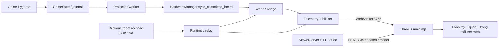

# Luồng 3 chế độ chơi trong môi trường ảo và robot thật, kèm web Three.js

Ngày đọc source: **23/10/2026**.

## 1. Bản code được phân tích

- Repo chính: `D:\OJT\xiangqi_robot_TrainningAI_Final_6`.
- Nhánh: `need-review`; HEAD tại lúc đọc: `18e67fc9006a91a2a32c4c861974760089a687de`.
- Phân tích **các file hiện có trong working tree, bao gồm thay đổi chưa commit**. Chỉ checkout HEAD không tái tạo được toàn bộ bản này.
- Worktree kiểm tra trước đó: `D:\OJT\_qa_userflow_20261019`; không dùng worktree đó làm nguồn thay cho source hiện tại.
- Tài liệu này mô tả đường đi trong source, không phải báo cáo chạy thử mới. Không chạy chương trình, camera hay lệnh chuyển động để lập tài liệu này.
- Graph code được dùng để tìm điểm bắt đầu; một số vị trí trong index cũ không khớp số dòng hiện tại. Các luồng bên dưới được đối chiếu lại với file thực tế.

### Mục lục

1. [Bản code được phân tích](#1-bản-code-được-phân-tích)
2. [Hai môi trường và ba chế độ](#2-hai-môi-trường-và-ba-chế-độ)
3. [Khởi động và dữ liệu dùng chung](#3-khởi-động-và-dữ-liệu-dùng-chung)
4. [Không có robot thật: ba luồng](#4-không-có-robot-thật-ba-luồng)
5. [Có robot thật: ba luồng](#5-có-robot-thật-ba-luồng)
6. [Web Three.js nhận và hiển thị dữ liệu](#6-web-threejs-nhận-và-hiển-thị-dữ-liệu)
7. [Kết thúc, reset, đổi chế độ và khôi phục](#7-kết-thúc-reset-đổi-chế-độ-và-khôi-phục)
8. [Các điểm dễ hiểu nhầm khi đọc](#8-các-điểm-dễ-hiểu-nhầm-khi-đọc)
9. [Bản đồ file và hàm](#9-bản-đồ-file-và-hàm)
10. [Thứ tự đọc theo một nước cụ thể](#10-thứ-tự-đọc-theo-một-nước-cụ-thể)

## 2. Hai môi trường và ba chế độ

### 2.1 Hai trục lựa chọn độc lập

**Môi trường thực thi** chọn ai thực hiện chuyển động: backend ảo hay FR3 thật. **Chế độ chơi** chọn ai quyết định nước đi: hai người, người và AI, hoặc hai bên AI.

Nguồn phân quyền là `SessionProfile`, được tạo bởi `make_profile()` và áp dụng bằng `configure_session()` trong [session_profile.py](/D:/OJT/xiangqi_robot_TrainningAI_Final_6/src/core/session_profile.py).

| Lệnh | Môi trường yêu cầu | Camera / FR3 | Mô phỏng và viewer |
|---|---|---|---|
| `python main.py` | VIRTUAL | Không dùng phần cứng | Có, mặc định |
| `python main.py --physical` | PHYSICAL | Có đối với HvR/RvR; ban đầu chỉ đọc robot | Viewer phản chiếu trạng thái nếu khởi tạo được |
| `python main.py --virtual` | VIRTUAL, game-only | Không dùng phần cứng | **Tắt mô phỏng**, không mở viewer |
| `python main.py --no-viewer` | VIRTUAL | Không dùng phần cứng | Giữ executor mô phỏng; không phục vụ/mở trang web |
| `python main.py --physical --no-viewer` | PHYSICAL | Theo chế độ chơi | Không phục vụ/mở trang web; không có nghĩa tắt robot thật |

`--physical` và `--virtual` loại trừ nhau. Cách đặt tên `--virtual` dễ gây nhầm nhưng đây là ý nghĩa thật của `parse_options()` hiện tại.

Đường dẫn terminal trên máy hiện tại:

```powershell
cd D:\OJT\xiangqi_robot_TrainningAI_Final_6
.\.venv312\Scripts\python.exe main.py
# Hoặc:
.\.venv312\Scripts\python.exe main.py --physical
```

### 2.2 Ma trận sáu trường hợp

| Môi trường yêu cầu | Chế độ | Người quyết định nước | Camera | Ai di chuyển quân | Trạng thái trên web |
|---|---|---|---|---|---|
| VIRTUAL | HUMAN_VS_HUMAN | Người Đỏ và người Đen | Không | Click cập nhật bàn; không gắp bằng robot | Quân được đối soát sang bàn 3D, tay đứng yên |
| VIRTUAL | HUMAN_VS_ROBOT | Người Đỏ, AI Đen | Không | Người click; robot ảo thực hiện nước AI | Quân người cập nhật; nước AI có chuyển động gắp/thả |
| VIRTUAL | ROBOT_VS_ROBOT | AI cả hai màu | Không | Một cánh tay ảo đi cho cả hai bên | Hiện chuyển động của cả hai màu |
| PHYSICAL | HUMAN_VS_HUMAN | Người Đỏ và người Đen | **Không** | Vẫn nhập bằng chuột | **Bị chuyển thành VIRTUAL**, giống dòng đầu |
| PHYSICAL | HUMAN_VS_ROBOT | Người Đỏ, AI Đen | Có | Người đi ngoài đời; FR3 đi quân AI | Khớp thật + animation lệnh kẹp + đối soát quân |
| PHYSICAL | ROBOT_VS_ROBOT | AI cả hai màu | Có | **Một FR3** lần lượt đi cả hai bên | Phản chiếu khớp/kẹp và trạng thái quân cả hai bên |

**Không có luồng Người vs Người bằng camera thật được bật trong profile hiện tại.** Dù một số hàm nhận dạng còn nhánh xử lý PvP, `make_profile()` đặt `physical=False` cho PvP nên startup không mở camera/SDK cho chế độ đó.

## 3. Khởi động và dữ liệu dùng chung

### 3.1 Từ terminal đến màn hình chọn chế độ

1. [main.py](/D:/OJT/xiangqi_robot_TrainningAI_Final_6/main.py) đọc CLI qua `parse_options()`, áp dụng `configure_runtime()` trong [launch_options.py](/D:/OJT/xiangqi_robot_TrainningAI_Final_6/src/core/launch_options.py).
2. Khởi tạo log, Pygame, `GameWindow`, `BoardRenderer` và `GameState`.
3. Hiện menu chính. Chưa tạo phiên phần cứng hoàn chỉnh ngay khi import màn hình.
4. Chọn menu qua `renderer.home_action_from_pixel()`; nhãn menu được đổi thành `HUMAN_VS_HUMAN`, `HUMAN_VS_ROBOT` hoặc `ROBOT_VS_ROBOT` trong vòng lặp `main.py`.
5. `startup_worker.start(...)` chạy `build_session()` ngoài luồng GUI.

### 3.2 `build_session()` tạo những gì?

File: [session_startup.py](/D:/OJT/xiangqi_robot_TrainningAI_Final_6/src/core/session_startup.py).

```text
build_session()
  -> configure_session() -> SessionProfile
  -> state.attach_journal(root, environment, mode)
  -> HardwareManager.initialize_all()
  -> TelemetryPublisher(...)
  -> manager.setup_digital_twin(telemetry)
  -> state.set_board_observer(manager.sync_committed_board), nếu bridge hỗ trợ bàn
  -> state.start_projection_worker()
  -> state.sync_current_board(), nếu bridge hỗ trợ bàn
  -> telemetry.start(), nếu có bridge
  -> check_viewer_assets() + ViewerServer.start(), nếu profile cho mở viewer
  -> trả manager, telemetry, viewer, reason
```

- Journal/lease được mở **trước** camera và SDK, tránh hai phiên cùng sở hữu môi trường.
- File dữ liệu mặc định nằm ở `D:\OJT\xiangqi_robot_TrainningAI_Final_6\data\runtime\virtual.sqlite3` hoặc `physical.sqlite3`.
- Phiên cũ chưa kết thúc sạch có thể đưa game vào recovery; không được hiểu mọi lần mở là ván mới hoàn toàn.
- `initialize_all()` chỉ tạo AI khi `ai_enabled`; tạo robot/backend khi có phần cứng hoặc mô phỏng; tạo camera khi `camera_enabled`.
- PvP có thể tiếp tục bằng chuột nếu scene ảo tùy chọn khởi tạo lỗi; profile lúc đó bị hạ xuống game-only.
- `_finish_startup()` nhận kết quả ở main, tạo `SelfPlayController`, `InputHandler`, `SessionControl`.
- HvR/RvR hiện menu độ khó. `_select_difficulty()` -> `HardwareManager.select_difficulty()` -> `_start_selected_game()`.
- PvP bỏ qua menu AI.

### 3.3 Những loại trạng thái cần phân biệt

File trung tâm: [game_state.py](/D:/OJT/xiangqi_robot_TrainningAI_Final_6/src/core/game_state.py).

| Dữ liệu | Ý nghĩa |
|---|---|
| `board[row][col]` | Bàn luật cờ 10 hàng × 9 cột; chứa ký hiệu loại/màu quân |
| `turn`, `current_fen`, `move_history` | Lượt chơi, FEN và lịch sử của game |
| `piece_ids[(row, col)]` | ID ổn định của từng quân; phân biệt hai quân cùng loại |
| `pending_move` | `MoveContext`: ID quân đi, quân bị ăn, nguồn/đích, actor và ID nước |
| `pending_ai_move` | Nước robot đang chuẩn bị/chạy, bàn dự kiến sau nước, màu đang đi |
| `pending_execution_binding` | Ràng buộc phiên/bàn/cấu hình thực thi để không chạy lệnh cũ |
| `board_revision` | Phiên bản bàn sau commit |
| `game_epoch`, `ai_epoch`, `human_commit_generation` | Loại kết quả AI/nhận dạng đã cũ và ngăn khởi động AI trùng |
| World/PyBullet | Pose vật thể, trạng thái attached/released/captured; khác với bàn luật |
| Telemetry robot | Sáu góc khớp, TCP, trạng thái kết nối/chuyển động/kẹp |

**Quy ước tọa độ:** UI và hàm nước đi thường dùng `(col, row)`. `board`, `piece_ids`, `MoveContext.src/dst`, `target_cell` dùng `(row, col)`. `create_move_context()` thực hiện việc đổi thứ tự. Đây là điểm cần chú ý khi đọc.

### 3.4 Commit khác với animation

- Người đi: chấp nhận một nước hợp lệ -> commit game -> đưa bàn đã commit sang world/viewer.
- Robot đi: tạo pending -> thực hiện chuyển động -> có kết quả phù hợp -> commit game -> đối soát bản hiển thị.
- Ở robot thật, commit còn yêu cầu camera xác nhận bàn dự kiến. `verify_physical_board()` gọi `state.note_verified_pending_board()`; `commit_pending_physical_move()` kiểm tra `_pending_verified` khi journal thuộc PHYSICAL.
- Lỗi cập nhật viewer/API sau commit không được biến thành lệnh robot chạy lại nước đó.

## 4. Không có robot thật: ba luồng

Phần này lấy `python main.py` làm trường hợp chính: `VIRTUAL`, `DRY_RUN=True`, có PyBullet. Biến thể game-only được ghi riêng ở mục 4.4.

### 4.1 Người vs Người — `HUMAN_VS_HUMAN`

**Thao tác:** click quân bên đang tới lượt -> click giao điểm đích. Hai bên lần lượt dùng cùng cửa sổ.

```text
Pygame MOUSEBUTTONDOWN
  -> GameWindow.map_event()
  -> InputHandler.handle_mouse_down(mx, my)
  -> BoardRenderer.pixel_to_grid()
  -> chọn quân theo state.turn
  -> xiangqi.is_valid_move()
  -> InputHandler._queue_or_run(commit_override)
  -> InputHandler._commit_human_move(source="MOUSE")
  -> HumanMoveCommitCoordinator.try_commit()
  -> GameState.process_human_move()
  -> commit + đổi lượt + FEN + revision
  -> projection của bàn đã commit
  -> world -> world_state -> Three.js
```

Chi tiết:

1. Profile đặt `mouse_input="BOTH_PLAYERS"`, `ai_enabled=False`, `robot_moves_enabled=False`, `camera_enabled=False`.
2. `handle_mouse_down()` chỉ chọn quân cùng màu `state.turn` và kiểm tra luật trước khi gửi commit.
3. `HumanMoveCommitCoordinator.try_commit()` chặn yêu cầu trùng, sai epoch, sai lượt và sai luật.
4. `process_human_move()` cập nhật bàn, ID quân, danh sách bị ăn, lượt, lịch sử, FEN và `board_revision`.
5. `is_human_turn` đúng cho cả hai màu ở PvP. Vì thế Đen cũng dùng cùng pipeline người đi.
6. `sync_current_board()` đưa toàn bộ bản đồ ID/ô đã commit sang world qua projection worker.
7. Quân bị ăn bị loại khỏi map quân đang trên bàn; world giữ biểu diễn quân bị ăn ở ngoài bàn theo logic captured.

**Cánh tay không thực hiện pick/place cho nước PvP.** Scene vẫn có thể hiển thị tay, nhưng nó đứng yên. `HardwareManager.is_robot_ready` trả false khi profile không có quyền robot; `execute_piece_move()` cũng từ chối.

SPACE không xác nhận thêm nước chuột. `_handle_space_key()` trả thông báo nước chuột đã được xác nhận tự động. Không có baseline camera trong luồng này.

### 4.2 Người vs Robot — `HUMAN_VS_ROBOT`

**Thao tác:** người chơi Đỏ click quân và đích; AI điều khiển bên Đen.

#### A. Nước của người

Giống chuỗi PvP ở mục 4.1, nhưng `mouse_input="VIRTUAL_TEST_ADAPTER"`, `is_human_turn` chỉ đúng khi `turn=="r"`.

Sau `process_human_move()`:

- `turn` chuyển sang `b`.
- `human_commit_generation` tăng.
- Bàn người đi được đồng bộ sang world; không gọi robot để diễn lại nước của người.

#### B. AI chọn và robot ảo đi

```text
main.py: nhánh "2d. Xử lý AI Turn"
  -> đủ điều kiện backend/phiên/lượt/bàn và không có lỗi pending
  -> GameState.can_start_ai_turn()
  -> GameState.mark_ai_turn_started()
  -> thread _ai_worker(job_token, board_snapshot)
  -> AIController.pick_move(snapshot, color="b")
  -> main nhận kết quả, kiểm tra token còn hiện hành
  -> MotionWorker.start(lambda: execute_ai_move(...), completed)
  -> execute_ai_move()
       -> create_move_context(actor=ROBOT)
       -> mark_move_pending()
       -> set_pending_physical_move()
       -> HardwareManager.execute_piece_move()
            -> execute_virtual_move()
            -> _execute_virtual_move()
            -> runtime.pick_piece()/place_piece()
       -> commit_pending_physical_move()
  -> completed(): publish_committed_fen(), kiểm tra kết thúc, làm mới baseline
  -> tới lượt Đỏ
```

- `ai_job_token` gồm epoch/generation; kết quả nghĩ từ ván cũ bị bỏ.
- `can_start_ai_turn()` chỉ cho bắt đầu theo một lần người commit hoặc retry được cấp rõ ràng; không tự tạo thêm nước từ cùng ảnh/SPACE.
- `execute_ai_move()` trong [ai_execution.py](/D:/OJT/xiangqi_robot_TrainningAI_Final_6/src/core/ai_execution.py) là nơi chuyển nước AI sang pending, gọi executor và commit.
- Nhánh mặc định `VISUAL_MOTION_ASYNC_ENABLED` dùng worker; source còn nhánh chạy trực tiếp nếu tắt cờ này.
- `is_robot_ready` trong môi trường ảo còn chờ projection của bàn hiện tại; tránh AI gắp trên scene chưa nhận nước người.

#### C. Không ăn quân và ăn quân trong executor ảo

File: [simulation_adapter.py](/D:/OJT/xiangqi_robot_TrainningAI_Final_6/src/hardware/simulation_adapter.py).

| Loại nước | Thứ tự trong `_execute_virtual_move()` |
|---|---|
| Đi thường | Kiểm tra ID/ô nguồn, đích trống -> `runtime.pick_piece(piece_id)` -> `runtime.place_piece(target_cell=...)` |
| Ăn quân | Kiểm tra đúng một quân đối phương ở đích -> `select_capture_slot()` -> gắp quân bị ăn -> đặt vào slot ngoài bàn -> kiểm tra đích đã trống -> gắp quân đi -> đặt vào đích |

File [runtime.py](/D:/OJT/xiangqi_robot_TrainningAI_Final_6/src/simulation/runtime.py), lớp `VirtualXiangqiSimulation`, thực hiện quỹ đạo và trạng thái world. `VirtualFR3Backend` thực hiện chuyển động/IK; `VirtualPhysicalWorld` và gripper quản lý vật thể/attachment. Collision guard của **mô phỏng** vẫn thuộc đường này.

Chuyển động thất bại không được coi là nước AI đã hoàn tất. `execute_ai_move()` đặt fault/pending để phục hồi thay vì tự đổi FEN rồi đi tiếp.

### 4.3 Robot vs Robot — `ROBOT_VS_ROBOT`

**Thao tác:** chọn chế độ và độ khó. `_start_selected_game()` bắt đầu continuous khi backend sẵn sàng. Không click quân để đi.

Một controller và một cánh tay ảo dùng luân phiên cho hai màu; không phải hai cánh tay độc lập.

File trung tâm: [self_play_controller.py](/D:/OJT/xiangqi_robot_TrainningAI_Final_6/src/core/self_play_controller.py).

```text
SelfPlayController.start(red_difficulty, black_difficulty, run_mode="continuous")
  -> READY
  -> main gọi tick()
  -> request_next_move()
       -> snapshot + color=state.turn + token
       -> THINKING, worker think()
       -> AIController.pick_move(snapshot, color, difficulty)
  -> tick() nhận kết quả và kiểm tra luật/token/board
       -> create_move_context(), mark_move_pending(), set_pending_physical_move()
       -> MOVING, worker move_robot()
       -> HardwareManager.execute_piece_move()
       -> executor ảo ở mục 4.2.C
  -> tick() kiểm tra kết quả MotionExecutionResult và board/token
       -> commit_pending_physical_move()
       -> publish_committed_fen()
       -> kiểm tra hết ván
       -> READY cho màu còn lại
```

- RvR không dùng nhánh AI bên Đen của `main.py`; nhánh đó yêu cầu mode HvR.
- Hai bên dùng cùng `AIController`; `pick_move()` có lock cho trao đổi engine. Source hỗ trợ tham số độ khó mỗi màu, nhưng luồng menu hiện truyền cùng lựa chọn cho Đỏ và Đen.
- `run_mode="step"` tồn tại ở controller; `request_next_move()`/F7 dành cho bước tiếp theo. `set_run_mode()` đổi nhịp khi trạng thái cho phép; không nên suy từ việc có F7 rằng menu hiện có đủ giao diện cấu hình step.
- F6 gọi `start()`; F8 yêu cầu kết thúc/dừng qua controller. Không nhầm F8 với kết quả thua theo luật.
- `FAULTED` dừng luồng, `PICK_PAUSED` dành cho thiếu tâm gắp trong đường vật lý, `ENDING` chờ công việc/dừng hoàn tất, `FINISHED` dành cho kết thúc tự nhiên.

### 4.4 Nếu dùng `--virtual`: game-only

Profile vẫn có ba chế độ chơi nhưng **không có executor PyBullet và không có viewer**.

| Chế độ | Thay đổi so với mô phỏng đầy đủ |
|---|---|
| PvP | Click -> luật -> commit; không projection sang scene 3D đang chạy |
| HvR | Người click; AI vẫn nghĩ. `execute_ai_move()` nhận `GAME_ONLY=True` và commit trực tiếp sau kiểm tra VIRTUAL/DRY_RUN |
| RvR | Controller vẫn nghĩ và đổi lượt. `HardwareManager.execute_piece_move()` trả `MotionExecutionResult.ok()` ở nhánh game-only; đây là kết quả bỏ qua chuyển động, không phải bằng chứng đã gắp |

`--no-viewer` khác: executor mô phỏng còn hoạt động, chỉ bỏ web HTTP/browser. Theo source startup, bridge/telemetry vẫn có thể được tạo nếu scene/backend tồn tại.

## 5. Có robot thật: ba luồng

### 5.1 Phần khởi tạo chung của HvR/RvR thật

Lệnh: `main.py --physical`. Profile đặt `camera_enabled=True`, `physical_robot_enabled=True`, `DRY_RUN=False` cho hai mode có robot.

1. `HardwareManager.initialize_all()` -> `_init_ai()` -> `_init_robot()` -> `_init_camera()`.
2. `_init_robot()` gọi `FR5Robot.connect()` trong [robot_VIP.py](/D:/OJT/xiangqi_robot_TrainningAI_Final_6/src/hardware/robot_VIP.py). Tên lớp còn là **FR5Robot**, trong khi hệ thống đang cấu hình robot FR3; cần đọc đúng lớp này.
3. `connect()` phục vụ kết nối/đọc; không tự cấp quyền chuyển động cho game.
4. `_calibrate_robot()` tạo `BorrowedPhysicalStateSource`, đọc từ cùng SDK handle; thử tạo provider bàn cho mirror nếu có metadata thích hợp.
5. `setup_digital_twin()` chọn bridge phù hợp, xem mục 6.3.
6. `_init_camera()` tạo recognizer, nguồn camera/calibration, `SnapshotDetector`, `CameraMonitor` và thành phần tìm tâm gắp tùy cấu hình.
7. `CameraMonitor.start()` chạy capture và detect riêng. `_capture_loop()` lấy ảnh; `_detect_loop()`/`_infer_frame()` công bố kết quả nhận dạng. `update_display()` vẽ cửa sổ, không phải nơi main tự làm toàn bộ inference cho mỗi frame.
8. Chọn độ khó -> `_start_selected_game()` chụp baseline. Nếu camera chưa xác nhận được, đặt trạng thái chờ đối soát.

### Quyền xem khác quyền di chuyển

- Bấm **Connect live** chỉ kết nối browser đến WebSocket Python; không gọi SDK enable.
- Main xử lý F9 để đặt yêu cầu xác nhận trong 30 giây; F10 gửi `HardwareManager.activate_physical_game(state, commissioned=True)` qua worker.
- Hàm này kiểm tra profile, kết nối, pending/fault/recovery, telemetry mới và đứng yên, bàn camera hiện tại; sau đó gọi `robot.activate_physical_control()`.
- RvR mở ban đầu ở trạng thái chỉ đọc sẽ chưa tự đi. Sau khi đủ quyền/readiness, dùng F6 khởi động controller theo đường hiện có.
- Không cần viewer đang mở để bản thân game có đường điều khiển FR3. Không dùng trạng thái web “LIVE THẬT” làm bằng chứng robot đã được cấp quyền đi quân.

### 5.2 Người vs Người khi mở bằng `--physical`

**Trường hợp này bị chuyển về PvP VIRTUAL.**

`make_profile()` tính `pvp=True`, rồi `physical = requested == "PHYSICAL" and not pvp`. Vì vậy:

- `requested_environment` vẫn ghi PHYSICAL để biết người dùng yêu cầu gì.
- `execution_environment/backend` thành VIRTUAL.
- Camera và FR3 không được tạo cho phiên đó.
- Hai người vẫn click theo lượt như mục 4.1; robot không gắp.
- Có scene/viewer nếu mô phỏng bật và khởi tạo được.

Các nhánh `CAMERA_HUMAN_VS_HUMAN` hay nhận dạng theo `state.turn` còn trong `InputHandler` là nhánh tương thích; không chứng minh có chế độ PvP vật lý được bật từ menu chuẩn.

### 5.3 Người vs Robot thật — `HUMAN_VS_ROBOT`

#### A. Người đi ngoài đời -> camera -> commit

**Thao tác bình thường:** người di chuyển quân Đỏ trên bàn thật, rút tay khỏi bàn. Chờ tự xác nhận nếu đủ điều kiện hoặc dùng SPACE theo nhánh hiện tại.

Mặc định source đang đặt `AUTO_MOVE_CONFIRM_ENABLED=True`, `PLAYER_TURN_MODE="SHADOW"` trong [config.py](/D:/OJT/xiangqi_robot_TrainningAI_Final_6/config.py).

```text
CameraMonitor: ảnh + detection + kết quả layout có thời điểm lấy mẫu
  -> main: nếu lượt người, auto-confirm bật, không bận/lỗi/menu
  -> InputHandler.poll_board_stability()
  -> get_latest_observation(), chỉ dùng mẫu mới
  -> kiểm tra baseline, nhận dạng, luật và độ ổn định
  -> _commit_human_move(source="AUTO")
  -> HumanMoveCommitCoordinator.try_commit()
  -> GameState.process_human_move()
  -> turn="b", generation tăng, FEN/revision đã commit
  -> projection quân lên world/viewer
```

Ba giá trị `PLAYER_TURN_MODE` có tác dụng khác nhau:

| Giá trị | Ai có quyền xác nhận |
|---|---|
| LEGACY | Pipeline phát hiện nước đi + `BoardStabilityMonitor` |
| SHADOW — hiện tại | Arbiter được quan sát song song; **pipeline legacy vẫn có quyền commit** |
| UNIFIED | `PlayerTurnArbiter.ingest()` sinh request; chỉ đường arbiter commit nếu đủ capability/visibility |

Không nên mô tả cấu hình hiện tại như đã chuyển toàn bộ sang UNIFIED. `PLAYER_TURN_INTERACTION_CAPABILITY` hiện là UNAVAILABLE; đây là một điều kiện cần đọc khi cân nhắc đổi chế độ.

**Nhánh SPACE:**

```text
InputHandler.handle_keyboard()
  -> _queue_or_run(... _handle_space_key ...)
  -> CameraMonitor.get_fresh_snapshot()
  -> kiểm tra T1 baseline, lưu rollback
  -> HardwareManager.recognize_board_state(frame), khi có CChess
  -> SnapshotDetector.detect_move(...)
  -> derive_move_observation() đối chiếu layout, nếu nhận dạng thành công
  -> xiangqi.is_valid_move(..., "r")
  -> _commit_human_move(source="SPACE")
```

- Nếu chưa có baseline, SPACE có thể chỉ chụp baseline rồi trả về; không đồng nghĩa vừa commit nước.
- Nếu không xác định được đúng một nước hợp lệ, game giữ FEN, báo lỗi/chờ đối soát, thay vì tự đoán nước.
- Ở UNIFIED, `_handle_space_key()` hiện báo SPACE chỉ yêu cầu poll state machine, không chạy nhánh legacy trên.
- Chuột trong physical không phải đường chơi thường: profile đặt `mouse_input="NONE"`. `emergency_mode` là đường override có chủ ý; thao tác trên màn hình ở đường đó không tự chứng minh ngoài đời đã di chuyển quân.

#### B. AI Đen -> FR3 đi quân -> camera -> commit

Việc chọn nước AI vẫn từ nhánh HvR ở `main.py`, giống mục 4.2.B. Khác biệt nằm ở nhánh thực thi:

```text
execute_ai_move()
  -> tạo MoveContext + pending + execution binding
  -> simulation_runtime is None
  -> execute_pending_ai_motion(state, hw)
       -> verify_physical_board(bàn trước nước)
       -> get_robot_center_pick_targets()
       -> require_pick_target(), nếu visual pick bật
       -> HardwareManager.execute_piece_move(...)
            -> kiểm tra quyền, telemetry, binding, target
            -> bridge.begin_command_animation(context), nếu có
            -> FR5Robot.move_piece()
            -> finally: bridge.finish_command_animation()
       -> verify_physical_board(bàn dự kiến sau nước)
       -> đánh dấu pending đã được camera xác nhận
  -> GameState.commit_pending_physical_move()
  -> publish + projection + _refresh_game_baseline()
  -> trả lượt người Đỏ
```

File điều phối nhận dạng/thực thi: [visual_move_coordinator.py](/D:/OJT/xiangqi_robot_TrainningAI_Final_6/src/core/visual_move_coordinator.py).

`verify_physical_board()` yêu cầu các quan sát mới liên tiếp, đủ chất lượng và **toàn bàn khớp bàn dự kiến**, không chỉ đủ tổng số quân. Source ưu tiên `get_fresh_observation()` để dùng mẫu nguyên tử đã nhận dạng, tránh suy luận lại không cần thiết.

#### C. FR3 thực hiện gắp/thả như thế nào?

Đường vật lý hiện dùng `FR5Robot.move_piece()` -> `_move_piece_sequence()` trong `robot_VIP.py`.

| Tình huống | Hàm và thứ tự chính |
|---|---|
| Đi thường | `pick_at(source, visual_target)` -> nâng thêm nếu xa -> `place_at(destination)` -> `go_to_home_chess()` |
| Ăn quân | `pick_at(destination, captured_visual_target)` -> `move_to_extra_safe()` -> `place_in_capture_bin()` -> callback kiểm tra đích đã sạch -> đo lại tâm quân nguồn -> `pick_at(source)` -> `place_at(destination)` -> HOMECHESS |

- `pick_at()` dùng `visual_target.col/row` dạng số thực để tính XY đã bù bằng `board_to_pose_bilinear()`. Nếu không có target, hàm cấp thấp có fallback tâm ô; nhưng đường game phía trên đang bật visual pick và yêu cầu target hợp lệ trước khi dispatch.
- `place_at()` đặt ở tâm ô đích theo mapping tọa độ đã dạy.
- `board_to_pose()`/`board_to_pose_bilinear()`, R1–R4, tool/user và các giá trị Z/config thuộc nguồn lệnh vật lý. Placement của viewer không thay thế nguồn lệnh này.
- `pick_at()` -> tiếp cận SAFE_Z -> hạ PICK_Z -> CLOSE -> nhấc lên.
- `place_at()` -> tiếp cận -> hạ PLACE_Z -> OPEN_MAX -> nhấc -> CLOSE_TO_SAFE_GAP.
- `place_in_capture_bin()` dùng điểm `R_Trash`; trở về HOMECHESS theo chuỗi trong source.
- `gripper_ctrl()` phát xung Tool DO qua `_pulse_gripper_direction()`, kết thúc đưa hai đầu ra về trạng thái idle. Thông tin `gripper_closed_estimate` là ước lượng theo lệnh.

**Quan sát đáng chú ý khi tự đọc:** `pick_at()` hiện không có bước OPEN_MAX riêng trước khi hạ xuống; OPEN_MAX nằm ở đường thả, sau đó có CLOSE_TO_SAFE_GAP. Vì vậy độ mở sẵn ở lần gắp tiếp theo phụ thuộc chuỗi kẹp trước đó và cấu hình xung. Tài liệu chỉ ghi lại source, chưa sửa hay kết luận đủ độ mở ngoài đời.

#### D. Dừng do thiếu tâm hoặc lỗi sau khi đã lấy quân bị ăn

- `PickTargetUnavailable` -> `pause_visual_pick()` lưu request gắn với chính pending/context/signature; chưa commit FEN.
- Nếu đã lấy quân bị ăn, callback `capture_cleared()` lưu checkpoint `CAPTURE_REMOVED` sau xác nhận camera.
- `refresh_moving()` lấy lại tâm quân nguồn sau thao tác ăn; không dùng lại tâm đã đo trước đó.
- Retry ở stage `capture_removed` không gắp lại quân đã lấy ra; nó kiểm tra checkpoint rồi tiếp tục quân nguồn.
- Sai epoch/bàn/binding làm retry bị từ chối. Retry không phải tạo một nước AI mới.
- Lỗi chuyển động hoặc không xác nhận được bàn sau nước đi vào fault/recovery; không tự coi đó là thiếu tâm trước gắp để chạy lại toàn bộ.
- Giá trị bù tâm hiện có `VISUAL_PICK_MAX_OFFSET_MM=6.0`, đồng thời còn giới hạn theo ô, confidence và ổn định; **6 mm không phải bỏ tất cả các điều kiện còn lại**.

### 5.4 Robot vs Robot thật — `ROBOT_VS_ROBOT`

**Thao tác:** chọn RvR/độ khó -> xác nhận bàn -> cấp quyền chuyển động -> F6 khi cần bắt đầu. Người dùng không tự đi Đỏ như HvR.

Controller vẫn là `SelfPlayController`; vòng `READY -> THINKING -> MOVING -> commit -> READY` giống môi trường ảo. Các chỗ khác:

1. `_is_physical()` nhận môi trường thật khi không có executor simulation và `dry_run=False`.
2. `start()` kiểm tra camera/bàn hiện tại và backend readiness; không đủ thì không bắt đầu.
3. Worker `think()` trong `request_next_move()` gọi `verify_physical_board(snapshot)` trước yêu cầu AI.
4. `color=state.turn`, nên cùng AI/controller gọi cho Đỏ rồi Đen luân phiên.
5. Worker `move_robot()` đi vào `execute_pending_ai_motion()`; dùng chính pipeline camera/tâm gắp/thực thi/đối chiếu sau nước ở mục 5.3.B–D.
6. `tick()` chỉ commit khi worker trả `MotionExecutionResult` thành công và token/bàn/lượt chưa đổi.
7. Hai màu cùng gọi một `HardwareManager` và một `FR5Robot`; không có kết nối/arm thứ hai.
8. Thiếu tâm -> `PICK_PAUSED`; Y hoặc Continue gọi `retry_visual_pick()` với đúng pending. Lỗi khác -> `_fault()`.
9. Đầu hàng qua `request_surrender()` có thể nhận khi đang nghĩ/đi. Nếu đang đi, controller chờ hoàn tất nước đang thực hiện trước khi kết thúc; không commit một nửa thao tác thành ván kết thúc.

Không có nhánh “để người cầm quân Đỏ giúp” trong RvR bình thường. Nếu can thiệp bàn, camera/token có thể từ chối lượt tiếp theo và yêu cầu phục hồi.

## 6. Web Three.js nhận và hiển thị dữ liệu

### 6.1 Ba phần chạy riêng



| Phần | File/chức năng | Vai trò |
|---|---|---|
| HTTP | `ViewerServer` trong `launch_options.py` | Phục vụ HTML, module JS, shared và Three.js local; mặc định 8088 |
| Backend/game | `main.py`, hardware/runtime/bridge | Quyết định và thực hiện thay đổi thật của game/world |
| WebSocket | `TelemetryPublisher` | Đưa snapshot/event và nhận lệnh viewer; mặc định 8765 |
| Browser | `robot-3d-viewer/main.mjs` | Dựng scene, nhận packet, cập nhật mesh và render |

HTTP tải được không chứng minh WebSocket đã nối. WebSocket mở không chứng minh SDK còn mới hoặc robot có quyền di chuyển.

`ViewerServer.start()` in URL có `ws=...&autoconnect=1`; browser `initApp()` có thể gọi `connectLive()` tự động. Bấm nút khi đã có `state.liveSocket` sẽ đóng kết nối hiện tại theo code `connectLive()`.

Nếu cổng bị chiếm, startup ghi unavailable và không nhận nhầm server khác đang chiếm cổng là server của phiên. Source có cờ `--viewer-port` và `--telemetry-port`; không có cơ chế tự chọn cổng khác trong đoạn startup này.

### 6.2 Trong môi trường ảo

```text
HardwareManager._init_robot()
  -> VirtualFR3Backend
  -> VirtualXiangqiSimulation(world=PyBullet)
  -> FixedBoardPoseProvider
setup_digital_twin()
  -> LiveTwinBridge dùng chung runtime.world
  -> runtime telemetry callbacks + bridge snapshot
  -> TelemetryPublisher.update_from_snapshot()/update_world_state()
  -> JSON -> browser
```

- Backend/runtime sở hữu chuyển động; browser không tự giải quỹ đạo để làm robot đi trong ván.
- Khi robot ảo đang di chuyển, runtime phát các mẫu trạng thái. Bridge dùng chung world và tránh ghi đè nó bằng snapshot polling cũ.
- Bàn sau nước người/commit được đưa qua `sync_committed_board()`; marker `_virtual_board_projection` ghi phiên/revision/scene đã đồng bộ.
- HvR/RvR chờ marker phù hợp trước khi bắt đầu nước robot ảo kế tiếp.

### 6.3 Trong môi trường robot thật: ba mức phản chiếu

| Điều kiện | Lớp | Có gì trên web? |
|---|---|---|
| Có provider bàn thích hợp | `LiveTwinBridge`, `physical=True` | Khớp thật, world/quân, command animation, placement từ provider |
| Không có provider bàn phù hợp nhưng tạo world được | `PhysicalStateRelay` | Khớp thật + quân đồng bộ trên bàn mô phỏng mặc định; `board_sync_available=True`, `uncalibrated_board=True` |
| World/bridge vật lý bị lỗi, startup fallback | `RawArmRelay` | Chỉ dữ liệu cánh tay; `board_sync_available=False`, không bảo đảm đồng bộ quân |

Nguồn snapshot thật là `BorrowedPhysicalStateSource.get_state_snapshot()` -> `PhysicalFR3Backend.get_state_snapshot()` trên SDK handle đang có; không mở arm độc lập chỉ để viewer đọc.

`sync_world_from_robot_snapshot()` trong [world_sync.py](/D:/OJT/xiangqi_robot_TrainningAI_Final_6/src/digital_twin/world_sync.py) áp sáu góc khớp vào world. Mirror vật lý giữ model tool gắn trên flange suy từ khớp; TCP controller còn phục vụ thông tin/đối chiếu.

**Đồng bộ quân khi FR3 gắp/thả:**

```text
HardwareManager.execute_piece_move(context)
  -> bridge.begin_command_animation(context)
       payload_sequence = [quân bị ăn nếu có, quân đang đi]
  -> robot.move_piece()
       -> gripper_ctrl()
       -> motion_listener("gripper", closed_estimate)
       -> bridge.animate_command_gripper()
            CLOSE: attach ID đang tới lượt vào gripper ảo
            OPEN: release ID đó
  -> finish_command_animation()
  -> camera xác nhận bàn sau nước
  -> GameState commit
  -> reconcile_to_board_cells(piece_ids) cho trạng thái cuối
```

Đây là kết hợp **khớp thật + ước lượng gắp theo lệnh + camera đối chiếu bàn**. Không có bằng chứng từ cảm biến lực/grasp sensor rằng kẹp đã giữ quân chỉ vì web hiện attached. Packet world trong relay còn ghi `physical_grasp_verified=False`.

Người nhấc quân bằng tay không tạo `motion_listener` của kẹp. Luồng người đi bình thường đồng bộ **sau khi nước được nhận dạng/commit**, không phải theo dõi 3D liên tục quân đang nằm trong tay người.

### 6.4 Nội dung packet

Nguồn: [telemetry_publisher.py](/D:/OJT/xiangqi_robot_TrainningAI_Final_6/src/hardware/telemetry_publisher.py).

| Packet | Nội dung và nơi dùng |
|---|---|
| `robot_state` | `joints`, `tcp`, `gripper`, `motion_state`, `trajectory_stage`, `source`, tính hợp lệ/freshness, `command_context` |
| `world_state` | Danh sách ID quân, pose world, quaternion, status, `captured`, `is_grasped`, `projection_context`, gripper world |
| `board_placement` | Transform/phiên bản bàn được backend công bố |
| Các event/result | Busy/lỗi/trạng thái thao tác và kết quả lệnh viewer |

`_stamp_packet_locked()` gắn `stream_id`, `packet_seq`. Heartbeat mục tiêu 25 Hz cho robot; world được gửi mỗi hai vòng heartbeat và có thể có cập nhật/event riêng. Đây là nhịp code cấu hình, không phải kết quả đo FPS/latency trên máy.

`_queue_packet()` và outbox mỗi client giữ snapshot mới nhất thay vì xếp vô hạn. Event có hàng đợi giới hạn; viewer quá chậm có thể bị đóng kết nối với lý do reconnect. Client chậm không được chặn tất cả client khác.

### 6.5 Browser áp snapshot vào model

File chính: [main.mjs](/D:/OJT/xiangqi_robot_TrainningAI_Final_6/robot-3d-viewer/main.mjs).

1. `initApp()` nạp geometry, scene placement, config, layout, asset kẹp/model rồi dựng bàn/quân/cánh tay.
2. `connectLive()` mở WebSocket và tạo `createLivePacketOrderGuard()`.
3. `socket.onmessage` parse JSON; guard từ [live_state.mjs](/D:/OJT/xiangqi_robot_TrainningAI_Final_6/robot-3d-viewer/live_state.mjs) loại packet cũ/sai stream theo từng type.
4. `robot_state` -> `applyLiveState()` -> `validateLivePacket()` -> gán `state.jointsDeg` -> `applyJointsDeg()`; đồng thời cập nhật readout, slider, source badge, trajectory và kẹp.
5. `world_state` -> `validateWorldStatePacket()` -> `worldStateMatchesContext()` -> `updatePiecesFromWorldState()`.
6. `worldStateMatchesContext()` so session/revision/epoch/scene/FEN/placement tương ứng, tránh vẽ world của ván cũ lên bàn mới.
7. `board_placement` -> `applyAuthoritativeBoardPlacement()`.
8. `loop()` chạy bằng `requestAnimationFrame`, áp góc khớp hiện tại, cập nhật kẹp/OrbitControls rồi `renderer.render(scene, camera)`.

File [board.mjs](/D:/OJT/xiangqi_robot_TrainningAI_Final_6/robot-3d-viewer/board.mjs), `updatePiecesFromWorldState()`:

- Tìm mesh theo ID quân, không chỉ theo ký hiệu “Xe/Tốt”.
- Gán `pose_world` vào position và quaternion world vào hướng quân.
- Quân không còn xuất hiện trong snapshot thì ẩn.
- `OUT_OF_BOUNDS` không phải captured thì ẩn; captured có thể tiếp tục hiện ngoài bàn.
- Lưu `status`, `captured`, `is_grasped` trong `mesh.userData`.
- Quân đang attached/captured không còn được coi là quân đang nghỉ trên một ô.

`requestAnimationFrame` không tự đảm bảo mọi stage sẽ xuất hiện nếu snapshot bị bỏ vì client chậm hoặc không khớp context. Nên tách “đã nhận góc khớp”, “đã nhận quân đúng revision” và “đã thấy đủ animation” khi kiểm tra.

### 6.6 Lệnh từ web ngược về backend

```text
Nút/jog/R1–R4 trên web
  -> sendLivePayload() hoặc handler tương ứng
  -> socket.send(JSON)
  -> TelemetryPublisher command handler
  -> HardwareManager._handle_virtual_viewer_command()
  -> runtime._handle_client_command()
  -> runtime._dispatch_client_command()
```

- Trong phiên game ảo, `viewer_command_context()` và `_validate_virtual_viewer_command()` kiểm tra session, revision, scene, placement và quyền `commands_allowed`.
- Piece-operation lock ngăn lệnh viewer tranh điều khiển với nước đang chơi/reset.
- Nhánh browser dùng `sendLivePayload()` kiểm tra socket/quyền/context; một số handler có đoạn gửi riêng, nên kiểm tra phía backend vẫn cần thiết.
- Trong phiên **physical**, bridge/relay đăng ký handler từ chối lệnh chuyển động từ viewer. Điều khiển vật lý đi từ game/operator flow, không phải mặc nhiên từ slider web.
- Đổi vị trí bàn mô phỏng không phải tự sửa R1–R4 nguồn lệnh robot thật. Tài liệu này không mở rộng sang chức năng dịch bàn tương lai.

## 7. Kết thúc, reset, đổi chế độ và khôi phục

### 7.1 Thắng/thua và đầu hàng

- `GameState._record_commit_result()` kiểm tra phía tới lượt không còn tướng hoặc không có nước hợp lệ, ghi kết quả cùng commit.
- `handle_game_over()`/`publish_match_end()` xử lý trạng thái kết thúc và kênh spectator.
- PvP/HvR nhận đầu hàng từ `InputHandler.handle_mouse_down()` khi input hợp lệ.
- RvR main chuyển đầu hàng qua `SelfPlayController.request_surrender()`; cần xét trạng thái nghĩ/đi trước khi kết thúc.
- Kết quả game không được xác định từ việc animation trên web đã dừng.

### 7.2 New Game

- Main có nhánh nhận New Game ngay cả khi một số worker/controller đang bận: `SessionControl.request("reset")` ghi yêu cầu và đi qua stop barrier.
- Khi rảnh, `InputHandler` còn đường queue `state.reset_game(hw)`; chính `reset_game()` cũng kiểm tra pending/lock/stop.
- `reset_game()` tạo lại board/IDs, tăng epoch, loại kết quả AI cũ và tạo phiên journal phù hợp.
- **Virtual:** scene nhận lại bàn khởi đầu; không cần xếp quân thật.
- **Physical:** game không tự dùng FR3 xếp lại 32 quân. Source đặt fault/chờ xác nhận bàn mới; người vận hành phải xếp và đối soát trước khi tiếp tục.

### 7.3 Về menu, đổi mode và thoát

- F2/nút chọn chế độ -> `_request_mode_menu()` trong main.
- `SessionControl.request()`/`poll()` điều phối stop, chờ worker, rồi cho reset/home/quit.
- `SessionDisposal.run()` trong [session_disposal.py](/D:/OJT/xiangqi_robot_TrainningAI_Final_6/src/core/session_disposal.py) đóng phiên theo thứ tự, gồm controller, camera/SDK, telemetry/viewer và dữ liệu phiên.
- Nếu chưa chứng minh đã dừng/worker còn chạy, phiên cũ được giữ để phục hồi; không mở mode mới đè lên tài nguyên chưa đóng.
- `rollback_session()` xử lý khởi tạo dở; `StartupRollbackError` giữ ownership nếu cleanup chưa hoàn tất.

### 7.4 Lưu trạng thái và projection

File: [game_persistence.py](/D:/OJT/xiangqi_robot_TrainningAI_Final_6/src/core/game_persistence.py), [session_journal.py](/D:/OJT/xiangqi_robot_TrainningAI_Final_6/src/core/session_journal.py), [projection_worker.py](/D:/OJT/xiangqi_robot_TrainningAI_Final_6/src/core/projection_worker.py).

```text
Game commit
  -> journal lưu snapshot + outbox
  -> ProjectionWorker.wake()
  -> _run() -> _submit(entry)
       twin: state._board_observer(piece_ids)
       spectator: API client.submit_board_projection(FEN...)
  -> ack hoặc giữ entry để retry có backoff
```

- `sync_current_board()` không luôn cập nhật world ngay tại chỗ; khi có projection worker nó yêu cầu projection.
- `publish_committed_fen()` cũng đánh thức worker khi có journal/worker; không nhất thiết gửi HTTP đồng bộ ngay trong hàm.
- Twin projection chỉ lấy snapshot còn hiện hành và tránh đang thao tác quân. Spectator giữ trật tự các revision/phiên được lưu.
- Worker này **không phát lệnh FR3** để sửa sai lệch hiển thị.
- API spectator trong `src/api/simulation_client.py` là dịch vụ chia sẻ trận/FEN; chữ “simulation” trong tên client không phải PyBullet hay web Three.js localhost.

## 8. Các điểm dễ hiểu nhầm khi đọc

| Điều nhìn thấy | Cách hiểu đúng từ source |
|---|---|
| Có cắm FR3/camera | Chưa chắc phiên đã chọn physical; profile quyết định |
| Chạy `--physical`, chọn PvP | Profile thực thi vẫn VIRTUAL, không camera/FR3 |
| Chạy `--virtual` | Tắt mô phỏng; không phải mở robot ảo |
| Có `simulation_runtime` | Có executor robot ảo; không phải dấu hiệu đang mirror FR3 thật |
| Có world/PyBullet ở physical | Có thể chỉ phục vụ phản chiếu; không dùng collision world đó để cấp phép quỹ đạo FR3 |
| Web LIVE THẬT | Có telemetry thật hợp lệ; không tự cấp quyền chuyển động game |
| Web quân đang attached | Ước lượng theo command animation ở physical, không phải xác nhận cảm biến gắp |
| Thiếu calibration mirror bàn | Vẫn có thể xem tay và đồng bộ quân trên bàn mặc định qua PhysicalStateRelay; RawArmRelay thì chỉ còn tay |
| `commit_pending_physical_move()` trong virtual | Đây là hàm commit pending robot dùng chung cho cả hai môi trường |
| Một `MotionExecutionResult.ok()` ở game-only | Bỏ qua chuyển động có chủ ý; không phải bằng chứng cơ học |
| Có lớp `MotionExecutor`/plan builder | Đường robot thật của game hiện gọi `FR5Robot._move_piece_sequence()`; không nên suy mọi helper kế hoạch đều là entrypoint của flow đang chơi |
| `PLAYER_TURN_MODE="SHADOW"` | Arbiter quan sát; legacy vẫn có quyền commit |
| SPACE sau nước chuột | Không cần; handler tránh commit lần hai |
| Viewer chậm sau nước đã commit | Projection có thể còn chờ; không tự chạy lại robot |
| Nhấc quân ngoài đời bằng tay | Chưa chắc web diễn lại động tác nhấc; thường chỉ cập nhật sau nhận dạng/commit |

### Phạm vi chưa được chứng minh bằng việc đọc code

- Phân tích này không khẳng định không còn race/deadlock hoặc đã đạt toàn bộ sáu flow trên phần cứng.
- Những ràng buộc trong source không thay cho đo độ mở kẹp, độ lệch tâm gắp hoặc camera thực tế.
- Các kết quả QA ngày 19/10 là bằng chứng riêng: luồng ảo chính đã chạy, nhưng bộ regression rộng còn 35 ca chưa xử lý xong. Không chạy lại những test đó để viết tài liệu này.
- Báo cáo cũ: [USER_FLOW_QA_20261019.md](/D:/OJT/xiangqi_robot_TrainningAI_Final_6/docs/USER_FLOW_QA_20261019.md).

## 9. Bản đồ file và hàm

| File | Hàm/lớp nên mở | Vai trò |
|---|---|---|
| [main.py](/D:/OJT/xiangqi_robot_TrainningAI_Final_6/main.py) | Vòng lặp cấp module, `_finish_startup`, `_select_difficulty`, `_start_selected_game`, `_refresh_game_baseline`, `_request_mode_menu` | Nhận input, menu, ghép phiên, điều phối AI HvR và poll controller |
| [session_profile.py](/D:/OJT/xiangqi_robot_TrainningAI_Final_6/src/core/session_profile.py) | `SessionProfile`, `make_profile`, `configure_session` | Ma trận quyền cho sáu trường hợp |
| [launch_options.py](/D:/OJT/xiangqi_robot_TrainningAI_Final_6/src/core/launch_options.py) | `parse_options`, `configure_runtime`, `check_viewer_assets`, `ViewerServer` | CLI, HTTP và mở viewer |
| [session_startup.py](/D:/OJT/xiangqi_robot_TrainningAI_Final_6/src/core/session_startup.py) | `build_session`, `rollback_session` | Tạo tài nguyên/bridge/projection và xử lý startup lỗi |
| [input_handler.py](/D:/OJT/xiangqi_robot_TrainningAI_Final_6/src/ui/input_handler.py) | `handle_mouse_down`, `handle_keyboard`, `_queue_or_run`, `_commit_human_move`, `_handle_space_key`, `poll_board_stability`, `_retry_visual_pick` | Đầu vào người chơi và phục hồi nhận dạng |
| [game_window.py](/D:/OJT/xiangqi_robot_TrainningAI_Final_6/src/ui/game_window.py) | `GameWindow.map_event` | Đổi tọa độ input từ cửa sổ resize về canvas |
| [board_renderer.py](/D:/OJT/xiangqi_robot_TrainningAI_Final_6/src/ui/board_renderer.py) | `pixel_to_grid`, `home_action_from_pixel`, `draw_ui`, `draw_pieces` | Bàn GUI và vùng click |
| [human_move_commit_coordinator.py](/D:/OJT/xiangqi_robot_TrainningAI_Final_6/src/core/human_move_commit_coordinator.py) | `HumanMoveCommitCoordinator.try_commit` | Một đầu commit nước người, chặn duplicate/stale |
| [game_state.py](/D:/OJT/xiangqi_robot_TrainningAI_Final_6/src/core/game_state.py) | `process_human_move`, `create_move_context`, `mark_move_pending`, `set_pending_physical_move`, `commit_pending_physical_move`, `_record_commit_result`, `sync_current_board` | Bàn/FEN/IDs/transaction |
| [xiangqi.py](/D:/OJT/xiangqi_robot_TrainningAI_Final_6/src/core/xiangqi.py) | `is_valid_move`, `make_temp_move`, `find_all_valid_moves`, `get_king_pos` | Luật và bàn dự kiến |
| [ai_controller.py](/D:/OJT/xiangqi_robot_TrainningAI_Final_6/src/ai/ai_controller.py) | `AIController.pick_move`, `_pick_move_locked` | Yêu cầu engine và chính sách độ khó |
| [ai_execution.py](/D:/OJT/xiangqi_robot_TrainningAI_Final_6/src/core/ai_execution.py) | `execute_ai_move` | Pending -> executor -> commit cho nước AI HvR |
| [self_play_controller.py](/D:/OJT/xiangqi_robot_TrainningAI_Final_6/src/core/self_play_controller.py) | `start`, `request_next_move`, `tick`, `retry_visual_pick`, `request_surrender`, `end_match`, `_fault` | Hai bên AI, lifecycle và recovery |
| [motion_worker.py](/D:/OJT/xiangqi_robot_TrainningAI_Final_6/src/core/motion_worker.py) | `MotionWorker.start`, `poll` | Công việc blocking và callback về main |
| [hardware_manager.py](/D:/OJT/xiangqi_robot_TrainningAI_Final_6/src/hardware/hardware_manager.py) | `initialize_all`, `_init_robot`, `_init_camera`, `is_robot_ready`, `activate_physical_game`, `execute_piece_move`, `verify_physical_board`, `sync_committed_board`, `setup_digital_twin` | Ghép backend, camera, quyền robot và sync |
| [visual_move_coordinator.py](/D:/OJT/xiangqi_robot_TrainningAI_Final_6/src/core/visual_move_coordinator.py) | `execute_pending_ai_motion`, `pause_visual_pick`, `retry_is_current` | Đối soát camera, tâm gắp, checkpoint ăn quân |
| [camera_monitor.py](/D:/OJT/xiangqi_robot_TrainningAI_Final_6/src/vision/camera_monitor.py) | `start`, `_capture_loop`, `_detect_loop`, `_infer_frame`, `get_latest_observation`, `get_fresh_observation`, `get_fresh_snapshot`, `update_display` | Ảnh và cache nhận dạng mới |
| [snapshot_detector.py](/D:/OJT/xiangqi_robot_TrainningAI_Final_6/src/vision/snapshot_detector.py) | `capture_baseline`, `detect_move`, `has_baseline` | So ảnh baseline và nhận nước người |
| [robot_VIP.py](/D:/OJT/xiangqi_robot_TrainningAI_Final_6/src/hardware/robot_VIP.py) | `FR5Robot.connect`, `activate_physical_control`, `move_piece`, `_move_piece_sequence`, `pick_at`, `place_at`, `gripper_ctrl` | Chuỗi SDK/DO thực tế |
| [simulation_adapter.py](/D:/OJT/xiangqi_robot_TrainningAI_Final_6/src/hardware/simulation_adapter.py) | `BorrowedPhysicalStateSource`, `VirtualVisualRobot`, `execute_virtual_move`, `_execute_virtual_move`, `select_capture_slot` | Chuyển đường game sang virtual hoặc đọc SDK đã có |
| [runtime.py](/D:/OJT/xiangqi_robot_TrainningAI_Final_6/src/simulation/runtime.py) | `VirtualXiangqiSimulation.pick_piece`, `place_piece`, `_on_robot_state_update`, `_handle_client_command`, `_dispatch_client_command` | Executor mô phỏng và lệnh viewer |
| [live_twin_bridge.py](/D:/OJT/xiangqi_robot_TrainningAI_Final_6/src/digital_twin/live_twin_bridge.py) | `poll_once`, `sync_robot_state`, `reconcile_to_board_cells`, `begin_command_animation`, `animate_command_gripper` | World và tay/quân qua bridge |
| [physical_state_relay.py](/D:/OJT/xiangqi_robot_TrainningAI_Final_6/src/digital_twin/physical_state_relay.py) | `PhysicalStateRelay.poll_once`, `reconcile_to_board_cells`, `animate_command_gripper` | Mirror tay/quân trên bàn mặc định |
| [raw_arm_relay.py](/D:/OJT/xiangqi_robot_TrainningAI_Final_6/src/digital_twin/raw_arm_relay.py) | `RawArmRelay.poll_once`, `start` | Fallback chỉ tay |
| [telemetry_publisher.py](/D:/OJT/xiangqi_robot_TrainningAI_Final_6/src/hardware/telemetry_publisher.py) | `start`, `_run_server`, `_make_packet_json`, `update_from_snapshot`, `update_world_state`, `_queue_packet`, `_heartbeat_loop` | WebSocket và snapshot |
| [projection_worker.py](/D:/OJT/xiangqi_robot_TrainningAI_Final_6/src/core/projection_worker.py) | `wake`, `_run`, `_submit`, `_drain_completions` | Retry hiển thị/API sau commit |
| [main.mjs](/D:/OJT/xiangqi_robot_TrainningAI_Final_6/robot-3d-viewer/main.mjs) | `initApp`, `connectLive`, `applyLiveState`, `sendLivePayload`, `loop` | Three.js scene, socket và render |
| [live_state.mjs](/D:/OJT/xiangqi_robot_TrainningAI_Final_6/robot-3d-viewer/live_state.mjs) | `createLivePacketOrderGuard`, `validateLivePacket`, `validateWorldStatePacket`, `worldStateMatchesContext` | Chặn dữ liệu cũ/sai schema/sai phiên |
| [board.mjs](/D:/OJT/xiangqi_robot_TrainningAI_Final_6/robot-3d-viewer/board.mjs) | `buildBoardGrid`, `buildPieces`, `updatePiecesFromWorldState` | Mesh bàn/quân và pose world |

## 10. Thứ tự đọc theo một nước cụ thể

### Ví dụ A: PvP, Tốt Đỏ e6 -> e5

`main.py` input -> `GameWindow.map_event` -> `InputHandler.handle_mouse_down` -> `xiangqi.is_valid_move` -> `_commit_human_move` -> `try_commit` -> `process_human_move` -> `_record_commit_result` -> journal/outbox -> `ProjectionWorker._submit` -> `sync_committed_board` -> `reconcile_to_board_cells` -> `world_state` -> browser `updatePiecesFromWorldState`.

Không cần đọc SDK để hiểu nước này; không có robot đi quân.

### Ví dụ B: HvR ảo, AI trả một nước ăn quân

Nhánh AI trong `main.py` -> `AIController.pick_move` -> `execute_ai_move` -> pending/context -> `HardwareManager.execute_piece_move` -> `_execute_virtual_move` -> gắp quân bị ăn/đặt capture slot -> gắp quân đi/đặt đích -> typed result -> commit -> projection.

Mở `runtime.pick_piece/place_piece` khi cần xem từng stage và chuyển động; mở `VirtualFR3Backend`/world/gripper khi cần đi sâu IK/vật lý.

### Ví dụ C: HvR thật, người đi rồi AI ăn quân

`CameraMonitor` -> `poll_board_stability` hoặc `_handle_space_key` -> commit người -> nhánh AI main -> `execute_ai_move` -> `execute_pending_ai_motion` -> xác nhận bàn trước -> đo tâm quân bị ăn -> `execute_piece_move` -> `FR5Robot._move_piece_sequence` -> lấy quân bị ăn -> xác nhận đích trống -> đo lại quân nguồn -> gắp/đặt -> camera xác nhận toàn bàn sau -> commit -> projection.

Song song đường đó: snapshot SDK -> relay -> `robot_state`; lệnh kẹp -> command animation -> `world_state`; browser kết hợp cả hai để hiển thị.

### Ví dụ D: RvR, đi từ Đỏ sang Đen

`SelfPlayController.start` -> `tick` -> `request_next_move` -> worker think với `color="r"` -> worker motion (ảo/thật tùy môi trường) -> `tick` commit -> `turn="b"` -> READY -> lặp cùng đường với màu Đen.

Đừng tìm nước AI Đỏ của RvR trong nhánh `state.turn=="b"` ở main: nhánh đó chỉ dành cho HvR.
