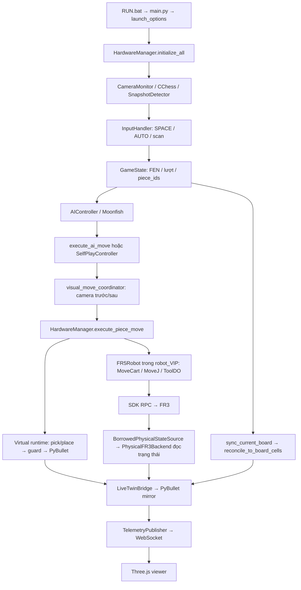

# Rà soát độ tin cậy các chế độ chơi với camera và FR3

Ngày đánh giá: **12/10/2026**, múi giờ Asia/Saigon.

## 1. Phạm vi và kết luận

Đây là **review tĩnh bản mã hiện tại**, theo yêu cầu chỉ đọc code khi người dùng không kết nối phần cứng. Không chạy game, simulator, trình duyệt, engine, pytest, camera hoặc SDK; không gửi lệnh robot. Không sửa mã ứng dụng, calibration, cấu hình hay các tài liệu trạng thái cũ. Hai artifact được tạo là báo cáo này và `PHYSICAL_GAME_RELIABILITY_AUDIT.snapshot.json`.

**Chưa nên xem bản hiện tại là sẵn sàng chạy các chế độ với FR3 thật.** Những kiểm tra tốt đã có chưa được nối thống nhất vào đường thực thi thực tế. Có đường gửi lệnh vật lý không qua collision guard của simulation; có trạng thái fault chặn luôn thao tác recovery; có timeout nhìn như đã giới hạn nhưng thực tế vẫn có thể chờ vô hạn.

Review ghi nhận **18 findings: 1 P0, 14 P1, 3 P2**. Tất cả finding được xếp **HIGH theo mã/control flow**, chưa phải VERIFIED bằng runtime. Severity phản ánh tác động của kịch bản, không chứng minh kịch bản đã xảy ra trên robot thật. Không quy kết các lỗi lịch sử của người dùng vào một nguyên nhân duy nhất khi chưa tái hiện.

- **P0:** thiếu gate bắt buộc trước chuyển động vật lý; cần chặn commissioning cho đến khi có bằng chứng phù hợp.
- **P1:** có thể làm treo, dừng ván, lệch trạng thái, mất recovery hoặc sai hệ tọa độ.
- **P2:** thiếu tính nhất quán chức năng/thông báo, cần hoàn thiện sau các gate chính.

## 2. Snapshot được review

| Thuộc tính | Giá trị |
| --- | --- |
| Repo | `D:/OJT/xiangqi_robot_TrainningAI_Final_6` |
| Branch | `feature/unified-robot-vs-robot` |
| HEAD | `7d8c5deee9e03bb187ccf8e8c1999703202cfd7e` |
| Working tree | Dirty: 35 tracked files thay đổi, cùng nhiều file untracked |
| Diff tracked tại thời điểm đọc | 1.760 insertions, 256 deletions so với HEAD |
| Nguồn thực thi được xét | File trên đĩa, gồm patch chưa commit và module untracked được import |
| Chứng cứ giữ lại | Manifest SHA-256 và số dòng của 42 file nguồn/test đã đọc; trạng thái Git trước khi tạo báo cáo |
| Phương pháp | Graph MCP, đọc nguồn cụ thể, truy vết caller/callee, đối chiếu diff và đọc test |
| Runtime/hardware/CI | Không thực hiện hoặc truy vấn trong đợt này |

Graph cũ trả `initialize_all` chỉ có 6 dòng, không khớp file đang sửa. Đã refresh index bằng `index_repository(mode=fast, persistence=false)`; index trả 11.133 nodes / 48.241 edges. Một số symbol adapter vẫn không có kết quả; đã đọc file thật thay thế. Kết quả graph chỉ dùng định vị, không dùng sự vắng mặt của edge làm bằng chứng duy nhất.

`PROJECT_CONTEXT.md` có mốc xác minh lịch sử và mô tả backend khác với đường hiện tại. `CURRENT_STATE.md` ghi các test/GUI smoke ngày 09/10, nhưng vẫn nói phần cứng chưa xác minh. Các số pass lịch sử không được dùng làm kết quả kiểm chứng mới.

Snapshot chỉ có ý nghĩa cùng working patch trong manifest; dùng HEAD một mình sẽ bỏ qua nhiều thay đổi đã review. Những module sạch so với HEAD như SDK, engine, API client, adapter và provider có vấn đề tồn tại trong baseline. Với file dirty chưa truy nguyên đến commit cụ thể, origin được ghi là chưa xác định; không tự gán lỗi cho nhánh visual hoặc unified.

## 3. Luồng thực tế và quyền quyết định

- `GameState` sở hữu bàn logic, lượt, lịch sử và ID quân. Camera cung cấp quan sát; không được tự ý thay trạng thái nếu transition không được chấp nhận.
- Virtual runtime sở hữu chuyển động mô phỏng và kiểm tra va chạm.
- Game vật lý thực sự dùng `FR5Robot` trong `robot_VIP.py`; tên lớp không đổi việc người dùng chọn FR3. `BorrowedPhysicalStateSource` dùng `PhysicalFR3Backend` để **đọc**, không đưa game qua executor vật lý của backend này.
- Bridge có API `begin_robot_move`, `set_expected_payload`, `on_gripper_closed/opened`, `end_robot_move`, nhưng đường game vật lý hiện tại không gọi chuỗi này. Sau commit, bàn được đối soát lại toàn bộ.
- Viewer là bên hiển thị/đề nghị thao tác. Khi mirror physical tồn tại, command handler của bridge từ chối điều khiển robot qua viewer.

## 4. Ma trận chế độ và cấu hình

Ba chế độ trong menu: `HUMAN_VS_HUMAN`, `HUMAN_VS_ROBOT`, `ROBOT_VS_ROBOT`.

| Cấu hình | Người vs người | Người vs robot | Robot vs robot | Simulation/viewer |
| --- | --- | --- | --- | --- |
| `python main.py` | Chuột, hai màu | Chuột Đỏ; AI Đen qua virtual runtime | Self-play qua virtual runtime, mặc định step | PyBullet + WS + HTTP khi chọn chế độ và bridge được tạo |
| `python main.py --virtual` | Game bằng chuột | AI commit logic, không motion | Adapter trả kết quả game-only, commit logic | **Tắt mô phỏng và viewer**, đúng yêu cầu người dùng |
| `python main.py --physical` | Camera; không cần bật quyền motion để người tự đi | Camera + FR3, sau operator enable và calibration | Camera + FR3 cho hai màu; sau enable cần F6 để bắt đầu nếu chưa ready khi chọn chế độ | Mirror đọc trạng thái nếu calibration hợp lệ; nếu không, chỉ HTTP preview offline |
| `--no-viewer` | Như backend đã chọn | Như backend đã chọn | Như backend đã chọn | Chỉ tắt HTTP/browser; không tắt runtime/mirror/WS |
| Virtual + camera thật | Không có lựa chọn độc lập trong CLI hiện tại | Không có cấu hình chính thức | Không có cấu hình chính thức | `_init_camera` return khi dry-run; có thể load ONNX nhưng không mở camera |
| Physical + không camera | Startup camera thất bại, trả về home | Không được bắt đầu | Không được bắt đầu | Không tự thay bằng camera giả/virtual |
| Physical + camera, robot/calibration unavailable | Có thể còn chơi bàn logic qua camera khi không có board observer; cần thông báo rõ thiếu mirror | Không đủ quyền chạy robot | Không đủ quyền self-play | Offline preview không chứng minh đồng bộ |
| Physical + robot giả/camera ghi hình | Có fixture ở các test, không có launcher chuyên dụng | Cần harness riêng để kiểm chứng | Cần harness riêng để kiểm chứng | Không được diễn giải test mocked là thử phần cứng |

HTTP và WS không mở ngay khi thấy home screen; chúng được tạo sau khi chọn chế độ và khởi tạo. Connect live chỉ kết nối WS local, **không** bật servo, commissioning hay sửa calibration. Camera mode mặc định `allow_mouse_move=False`: click quân không thực hiện nước thật là hành vi có chủ ý. Cần làm rõ trên UI, thay vì hướng dẫn người dùng cứ bấm Connect live để robot ready.

## 5. Findings có dẫn chứng

Mỗi kịch bản dưới đây là ca tái hiện **đề xuất**, chưa chạy trong đợt chỉ đọc mã này.

### F01 — P0 — Đường game vật lý không dùng kiểm tra toàn quỹ đạo của simulator

**Vị trí:** `src/hardware/hardware_manager.py:169–205,531–563`; `src/hardware/robot_VIP.py:158–179,317–386,500–674`; đối chiếu `src/hardware/simulation_adapter.py:114–184`.

**Chứng cứ:** Virtual đi qua runtime có guard; physical gọi `self.robot.move_piece`, rồi `MoveCart/MoveJ` trực tiếp. `_require_actuation` chỉ kiểm tra connected/authorized; `_validate_pose` kiểm tra finite và envelope XY ±900 mm. Không có validation quỹ đạo, joint-limit/geometry parity/placement version của scene trước những RPC này. Hover physical cũng gọi `robot.hover_at` trực tiếp.

**Kịch bản/tác động:** Một target đúng ô và có camera xác nhận vẫn có thể cần đường đi sát bàn hoặc cánh tay. Virtual từ chối vì collider, nhưng game physical không hỏi cùng guard trước khi gửi lệnh. Controller có thể có bảo vệ riêng; chưa có bằng chứng cấu hình đó thay thế được kiểm tra hình học dự án. Không khẳng định đã va chạm ngoài đời.

**Đề xuất:** Một gate motion chung cho game, self-play, hover/test và recovery, dùng cùng provider/tool geometry và một operation owner. Preflight toàn chuỗi với trạng thái khớp đo mới; khóa phiên calibration/placement; kiểm tra hoàn tất bằng controller. Chưa đủ parity thì chặn motion, không giảm margin. Giữ simulator và typed result hiện có.

**Blast radius/kiểm chứng:** Hardware dispatch, physical planner, robot facade, manual test; cần fixture obstacle ở giữa đường, target reachable nhưng route unsafe, và thay phiên placement. Assert không có RPC motion nếu gate thất bại. **Confidence HIGH; origin chưa truy nguyên toàn bộ vì facade/manager dirty, adapter baseline vẫn chia hai đường.**

### F02 — P1 — Calibration/motion có hai phép ánh xạ và hai hợp đồng chiều cao

**Vị trí:** `src/hardware/simulation_adapter.py:41–87`; `src/domain/board_pose_provider.py:157–170,368–379,730`; `src/hardware/robot_VIP.py:290–309,507–519,535–546`; `config.py:15–16,35–37,91–93`.

**Chứng cứ:** Provider fit rigid từ contact offset và cho phép residual theo policy đến mức mm; adapter lại yêu cầu mỗi ô XY khớp bilinear trong **0,001 mm**. Bilinear cộng `OFFSET_X/Y`, dùng XYZ của teaching point cho XY nhưng thay Z bằng `SAFE_Z/PICK_Z/PLACE_Z` tuyệt đối. Surface và tilt của provider không quyết định Z gắp/thả.

**Kịch bản/tác động:** Điểm đo có residual nằm trong policy calibration nhưng bị parity gate từ chối. Board nghiêng/độ cao khác có thể fit được, nhưng motion vẫn dùng Z cũ. Cấu hình hiện tại `BOARD_CALIBRATION_OFFSET_MM=None` chủ động chặn mirror — đây là thiếu dữ liệu, không nên bỏ guard để “sửa” Connect live. `OFFSET_X=5 mm` cũng phải được giải thích trong cùng transform, không tùy ý đặt offset calibration để ép gate pass.

**Đề xuất:** Một ánh xạ chuẩn duy nhất cho các ô và pose motion. Profile lưu rõ điểm chạm, tool/controller frame, mặt bàn, grasp/approach heights và provenance. Quyết định mô hình rigid hay grid đo trước, renderer/guard dùng cùng mô hình. Tolerance dựa trên sai số đo và yêu cầu gắp; không thay bằng một số lớn tùy tiện.

**Kiểm chứng:** Grid đo có residual nhỏ khác 0, dịch/quay bàn, mặt bàn khác Z, offset trong TOOL/BASE. So sánh 90 target được dùng thực sự, gồm Z, với provider/collider. **HIGH; provider/adapter baseline, config/facade dirty.**

### F03 — P1 — Quyền đã enable không đồng nghĩa robot vẫn sẵn sàng trước mỗi bước

**Vị trí:** `src/hardware/hardware_manager.py:93–99,213–230`; `src/hardware/robot_VIP.py:127–160`; `src/core/visual_move_coordinator.py:42–127`; `src/digital_twin/live_twin_bridge.py:99–114,124–197`.

**Chứng cứ:** F9/F10 xác minh fresh idle một lần. Sau đó `is_robot_ready` chỉ dựa connected/dry/authorization; `_require_actuation` tương tự. Camera verification không xác minh tình trạng controller. `twin._fail` không thu hồi authorization hoặc cập nhật GameState; snapshot invalid bị bridge từ chối nhưng không tự chặn lệnh kế tiếp của facade.

**Kịch bản/tác động:** Sau enable, stream stale/mất socket/status lỗi; camera vẫn nhìn rõ. Luồng game có thể tiếp tục tới RPC với authorization cũ. SDK có `GetSafetyCode` nhưng không thay thế freshness/collision gate của ứng dụng.

**Đề xuất:** Readiness tập trung, đánh giá lại trước stage: telemetry age/status/idle phù hợp, calibration version, fault latch và quyền operator. Latch fault chặn motion mới; không tự Home/disable vật lý nếu chưa xác định hành động phù hợp.

**Kiểm chứng:** Enable rồi cho packet đứng yên/mất kết nối/E-stop, camera vẫn hợp lệ; assert không dispatch motion/gripper tiếp theo. **HIGH; origin chưa xác định trong các file dirty.**

### F04 — P1 — SDK có retry vô hạn và có thể gửi lại lệnh sau lỗi socket

**Vị trí:** `src/hardware/robot_sdk_core.py:192–201,1098–1133,1748–1775`; `src/core/motion_worker.py:18–60`.

**Chứng cứ:** Decorator `xmlrpc_timeout` không đặt deadline; `while reconnect_flag` không giới hạn; `while flag` bắt `socket.error` rồi tiếp tục gửi cùng RPC. Thread motion giữ busy cho đến khi operation trả về. Chờ close 5 giây không hủy call đã treo.

**Kịch bản/tác động:** Lỗi network có thể làm phiên không kết thúc. Nếu controller nhận lệnh nhưng response mất, client retry mà không phân biệt “chưa gửi” với “đã nhận chưa rõ kết quả”. Chưa kiểm chứng controller có chống lặp; không được coi retry motion là an toàn.

**Đề xuất:** Deadline/cancellation cho transport và đọc; với motion/gripper, mất response phải trở thành trạng thái kết quả chưa rõ, chặn lệnh mới và yêu cầu đối soát. Không auto resend lệnh actuation; không cố kill Python thread như một lệnh stop robot.

**Kiểm chứng:** RPC luôn lỗi socket, reconnect không kết thúc, response lost sau accept; assert thời gian bounded và không replay actuation. **HIGH; SDK baseline sạch so với HEAD, worker untracked.**

### F05 — P1 — Timeout Moonfish bị vô hiệu bởi blocking readline

**Vị trí:** `src/ai/moonfish_engine.py:113–145,215–229`; `main.py:375–406`; `src/core/self_play_controller.py:178–219`.

**Chứng cứ:** Có deadline 10/30 giây, nhưng `stdout.readline()` và lúc startup `stderr.readline()` blocking. Deadline chỉ được xét sau khi readline trả về. Child còn sống nhưng không ghi newline có thể giữ worker mãi; AIController lock ngăn các request sau.

**Đề xuất:** Reader thread/queue bounded hoặc transport đọc có timeout thật; drain stderr; bắt buộc handshake `ucciok`; watchdog request gắn epoch, đóng process lỗi có kiểm soát và giải phóng lock. UI phải hiển thị timeout và retry rõ.

**Kiểm chứng:** Engine giả alive nhưng im lặng, partial line, stderr nhiều dữ liệu, không gửi `ucciok/bestmove`; đo deadline và khả năng request sau. **HIGH; engine baseline.**

### F06 — P1 — Self-play fault/ended khóa luôn đường recovery trong UI

**Vị trí:** `src/core/self_play_controller.py:69–70,115–117,317–351`; `main.py:307–343`; `src/ui/input_handler.py:605–625,651–741`.

**Chứng cứ:** `human_input_disabled=True` cả FAULTED và ENDED. Main không forward V/F4/New Game/Continue sang InputHandler; nhánh chuột self-play chỉ xử lý Next/Surrender, mà surrender chỉ được chấp nhận ở READY. Sau `_fault` cần đối soát bàn nhưng phím đối soát bị chặn; F6 lại từ chối khi fault sync còn tồn tại.

**Đề xuất:** Tách quyền di chuyển quân khỏi quyền scan/recovery/new game sau khi worker đã dừng. Controller phải có transition recovery/end/reset rõ, không dùng một boolean chặn tất cả.

**Kiểm chứng:** Inject motion/camera/engine fault qua main event routing, bấm V/F4/New Game; sau surrender phải tạo ván mới được. Assert không motion trong recovery. **HIGH; PRE-EXISTING ở HEAD theo đối chiếu property và routing; patch mới thêm một số nút nhưng chưa mở recovery.**

### F07 — P1 — Vẫn có nhiều I/O/inference chặn trên UI thread

**Vị trí:** `main.py:206–226,277–302,348–363,424–454`; `src/ui/input_handler.py:343,447–484,743–789`; `src/core/self_play_controller.py:130–138,169–177`; `src/core/game_state.py:455–456`; `src/api/simulation_client.py:37,68–90`.

**Chứng cứ:** Startup, chọn difficulty/restart engine, enable physical verification, SPACE/scan/recovery và precheck self-play chạy đồng bộ. `get_fresh_snapshot` flush/read rồi inference; caller có thể recognize lại cùng frame. API post có timeout 5 giây/lần, gửi FEN retry mặc định 3 lần + backoff chạy trong human commit hoặc completion callback trên UI. Virtual AI motion cũng chạy đồng bộ trong main.

**Tác động:** Game/camera display không pump event trong thời gian chờ. Log `ui.slow_frame` chỉ ghi sau khi call trả về; một call không trả về sẽ không có warning này. Không kết luận việc browser đơ cùng lúc có cùng nguyên nhân; WS có thread riêng.

**Đề xuất:** Một job coordinator cho startup/camera verification/engine management/API và virtual motion; UI chỉ submit/poll immutable result. Giữ thao tác phục hồi không actuation luôn phản hồi. API spectator không nằm trong critical path của local game. Đừng chỉ thêm thread cho motion rồi cho callback làm I/O blocking.

**Kiểm chứng:** Delay mỗi dependency, đo frame/event latency khi SPACE/F6/F10/scan/commit; đảm bảo QUIT/recovery phản hồi. **HIGH; vừa có baseline I/O vừa có patch async chưa bao quát.**

### F08 — P1 — Startup catch chưa bao quát twin/WS; lỗi fatal có thể exit 0

**Vị trí:** `main.py:206–226,472–476`; `src/hardware/telemetry_publisher.py:212–222`; `RUN.bat:83–103`.

**Chứng cứ:** Local catch chỉ bọc `initialize_all`. `setup_digital_twin`, sync và `telemetry.start()` nằm ngoài catch đó. WS bind lỗi sẽ raise RuntimeError; lên catch ngoài cùng chỉ log APP_UNHANDLED, kết thúc main mà không exit nonzero. RUN.bat nhận 0 rồi in “kết thúc an toàn”.

**Đề xuất:** Startup transaction chung cho hardware/twin/WS/HTTP/input/controller, cleanup từng resource owned khi fail; giữ home + lý do retry hoặc thoát lỗi thật. Exception fatal phải có exit code !=0. Giữ thông báo port và tùy chọn đổi cổng, không kill process khác.

**Kiểm chứng:** WS port occupied, bridge/world constructor fail, initial scene sync fail; assert GUI còn usable hoặc exit nonzero, không startup nửa vời. **HIGH; WS unhandled PRE-EXISTING ở HEAD; patch startup catch hiện tại vẫn chưa bao quát.**

### F09 — P1 — Gripper và quân đang mang chưa nối vào mirror physical

**Vị trí:** `src/hardware/simulation_adapter.py:24–39`; `src/hardware/backends/physical_fr3.py:65,528,696`; `src/hardware/robot_VIP.py:448–488`; `src/digital_twin/live_twin_bridge.py:293–378`; `src/hardware/hardware_manager.py:169–211`.

**Chứng cứ:** Reader được tạo với `_gripper_closed=False`; game dùng ToolDO của robot facade, không gọi reader `set_gripper`, không cập nhật reader cache. Các callback payload/move của bridge không có caller trong game path đã đọc; graph `begin_robot_move` inbound cũng trống. `sync_current_board` sau commit đưa quân tới bàn mới.

**Tác động:** Joints có thể theo FR3, nhưng ngàm vẫn open và quân không theo tay trong lúc di chuyển; ăn quân biến mất chủ yếu ở commit. Khả năng test riêng `LiveTwinBridge` attach/pass không chứng minh integration game này có hoạt động.

**Đề xuất:** Nối semantic move và command edge sau lệnh gripper thành công vào mirror, hoặc công bố rõ mirror chỉ có joints + board ở ranh giới nước đi. Trạng thái ngàm theo command phải gắn nguồn `COMMAND_ESTIMATE`, không giả là cảm biến. Không dùng animation attachment làm điều kiện chứng minh gắp thật.

**Kiểm chứng:** Qua manager và facade thật với RPC giả, inspect telemetry giữa GRIP/LIFT/RELEASE, ordinary/capture hai màu, failed ToolDO; không gọi hook trực tiếp từ test để thay cho integration. **HIGH; adapter/backend baseline, facade/manager dirty.**

### F10 — P1 — Viewer có thể báo LIVE THẬT với pose cũ/không hợp lệ

**Vị trí:** `robot-3d-viewer/live_state.mjs:1–31,134–136`; `robot-3d-viewer/main.mjs:692–746,771–930`; `src/digital_twin/live_twin_bridge.py:99–114,144–145`; `src/hardware/telemetry_publisher.py:333–355`.

**Chứng cứ:** `validateLivePacket` không xét connected, joints_valid, tcp_valid hoặc measurement age. `applyLiveState` tô LIVE THẬT theo source. Socket handler không xử lý `twin_status`; `isLiveStale` tồn tại nhưng không được main sử dụng. Bridge reject stale trước khi update telemetry, trong khi heartbeat có thể tiếp tục gửi state cũ.

**Đề xuất:** Phân biệt socket open, valid measured state, stale/offline và preview. Watchdog dựa measurement time/sequence, xử lý twin_status và hiển thị reason; giữ pose cuối với nhãn stale. Có timeout connect và không cho callback socket cũ ghi đè socket mới.

**Kiểm chứng:** WS sống nhưng robot stream đứng yên; nhận joints_valid=false; twin_status; server ngừng publish; connect/reconnect lỗi. Assert không còn badge fresh/live sai. **HIGH; main dirty, validation helper baseline.**

### F11 — P1 — AUTO xác nhận nước người bỏ qua confidence mà SPACE có xét

**Vị trí:** `src/ui/input_handler.py:994–1058,807–814`; `src/vision/snapshot_detector.py:105–128`; `src/vision/move_observation.py:94–113,168–181`; `config.py:122,135`.

**Chứng cứ:** Mặc định AUTO enabled và mode SHADOW, legacy path vẫn có quyền commit. Camera worker trả success + confidence; detector chuyển chỉ `board` vào `derive_move_observation`, không truyền confidence. Poll kiểm tra luật rồi chờ label ổn định. SPACE truyền confidence_grid khi cross-check; verify physical board dùng confidence đầy đủ.

**Kịch bản/tác động:** Các label confidence thấp nhưng lặp đúng một legal successor được AUTO commit; AI sau đó có thể bị camera precheck chặn. Người dùng thấy lượt/game đi trước quan sát đủ tin cậy, dù những hàm khác có quality gate.

**Đề xuất:** Dùng một observation validator chung cho SPACE/AUTO/HvH/recovery; truyền confidence, age, calibration và quality đầy đủ trước ổn định. Label lặp lại không thay thế confidence.

**Kiểm chứng:** Legal successor với source/destination confidence thấp lặp đủ samples; AUTO và SPACE cùng reject, FEN/lượt/ID không đổi. **HIGH; detector baseline, poll dirty.**

### F12 — P1 — Commit trả false dù FEN đã thay đổi và pending đã xóa

**Vị trí:** `src/core/game_state.py:371–408,723–738`; `src/core/ai_execution.py:81–87`; `src/core/self_play_controller.py:301–303`; `src/ui/input_handler.py:653–699`.

**Chứng cứ:** `commit_pending_physical_move` sửa board/lượt/history/IDs, xóa pending, rồi trả `sync_current_board()`. Nếu observer fail, kết quả False nhưng nước đã commit và checkpoint pending đã mất. Caller diễn giải như không commit/State commit rejected. Human commit cũng giữ trạng thái mới khi mirror fail, nhưng cần hợp đồng kết quả rõ.

**Đề xuất:** Typed commit result phân biệt `game_committed`, `scene_synced`, `recovery_required`, move_id và pre/post FEN. Không rollback chuyển động thật vì spectator fail. Giữ checkpoint cho retry đồng bộ idempotent, chặn replay motion và tự chuyển lượt tiếp khi scene fault.

**Kiểm chứng:** Camera xác nhận expected nhưng observer false/exception; assert một lần history/turn commit, move ID giữ được và retry sync không gửi motion. **HIGH; game_state dirty, chưa xác định commit đưa lỗi vào.**

### F13 — P1 — Cleanup có thể dừng giữa chừng và không đóng SDK connection owned

**Vị trí:** `main.py:134–155`; `src/hardware/hardware_manager.py:441–468`; `src/core/motion_worker.py:53–60`; `src/core/self_play_controller.py:94–98`; `src/hardware/robot_sdk_core.py:11039–11062`.

**Chứng cứ:** Cleanup tuần tự; self-play close, worker close, bridge close hoặc camera stop raise thì các bước sau không chạy. SDK có CloseRPC nhưng manager/facade không gọi. Partial startup camera fail sau khi robot connect có thể giữ receiver/socket cũ qua lần retry. Worker treo không được đóng resource đang dùng là đúng, nhưng không nên vì vậy bỏ cleanup mọi resource độc lập còn lại.

**Đề xuất:** Resource ownership ledger, đóng độc lập bằng try/finally, collect lỗi; chỉ giữ những resource worker còn dùng. Sau khi readers/workers dừng, đóng RPC owned có deadline. Read-only session không gửi lệnh gripper/enable trong cleanup. Failed commissioning cần lưu rõ Mode/Enable đã thay đổi đến đâu.

**Kiểm chứng:** Camera init fail sau connect, hai lần retry; worker close timeout; camera stop error; đếm thread/socket/process owned. Đảm bảo các resource độc lập vẫn đóng và không actuation trong read-only cleanup. **HIGH; dirty lifecycle, CloseRPC baseline.**

### F14 — P1 — R_Trash/Home bị mất metadata frame khi sử dụng với frame bàn đã đổi

**Vị trí:** `src/hardware/robot_VIP.py:197–248,341–363,396–405,562–572`; `src/hardware/simulation_adapter.py:54–85`.

**Chứng cứ:** Loader chỉ lưu pose + joints cho R1–R4 và R_Trash, bỏ tool/user metadata. Provider đọc lại frame bàn và gán `robot.tool_num/user_num` từ R1. MoveJ tới trash dùng frame toàn cục của bàn, không xác minh frame riêng của R_Trash. Precheck capture xét finite pose/joints, không xét metadata. Loader còn thông báo sẽ dùng backup khi thiếu trash, nhưng execution thật lại từ chối.

**Kịch bản/tác động:** Trash được dạy bằng tool/user khác R1 được gửi lại dưới frame của R1, hoặc ván chỉ lỗi khi lần đầu ăn quân vì chưa kiểm tra trash từ đầu.

**Đề xuất:** Giữ raw teaching metadata và xác minh tool/user của mọi waypoint dùng cho motion/capture/home; chuyển đổi rõ hoặc reject trước chạy. Tách capability ordinary/capture, thông báo thiếu trash trước ván và loại thông báo backup sai.

**Kiểm chứng:** R1 user=0 nhưng R_Trash user=1/tool khác; missing trash; assert không RPC capture, thông báo đúng. **HIGH; loader/facade dirty, adapter baseline.**

### F15 — P2 — Baseline thiếu quân vẫn được coi là thành công; caller bỏ qua kết quả

**Vị trí:** `src/vision/snapshot_detector.py:57–82`; `src/hardware/hardware_manager.py:764–772`; `main.py:124–132,433–440`.

**Chứng cứ:** Có frame thì capture_baseline trả True, không so occupancy với bàn logic, không quality/identity gate. `_start_selected_game` và callback sau robot bỏ qua bool capture. “T1 captured: 22” không chứng minh bàn đủ 32; ngược lại count 32 cũng chưa chứng minh đúng layout.

**Đề xuất:** Baseline gắn với board generation/calibration và thể hiện quality/readiness; khởi đầu đối chiếu expected layout, các lượt sau dùng số quân theo game. Caller phải đưa failure vào recovery UI. Không cố sửa bằng kiểm tra luôn đủ 32 vì ăn quân giảm count hợp lệ.

**Kiểm chứng:** Frame hợp lệ nhưng thiếu box, inference fail, baseline old sau reset; báo chưa ready, không âm thầm chơi tiếp hoặc kẹt AUTO không có hướng dẫn. **HIGH; detector baseline, caller dirty.**

### F16 — P2 — AUTO ở người vs người chỉ xử lý Đỏ

**Vị trí:** `src/core/game_state.py:411–413`; `main.py:359–363`; `src/ui/input_handler.py:949–953,1035–1038,756–757`.

**Chứng cứ:** Main poll cả hai lượt ở HvH nhưng poll return khi turn !=r và detector luôn suy diễn Red. SPACE có nhánh HvH suy diễn theo state.turn, nên xác nhận thủ công Đen có thể hoạt động.

**Đề xuất:** Nếu AUTO áp dụng HvH, dùng current actor/color ở cùng observation validator; nếu chỉ dành HvR thì UI nói rõ. Không để cùng UI AUTO nhưng hai lượt có hành vi khác không được giải thích.

**Kiểm chứng:** Hai legal move liên tiếp Đỏ/Đen với camera fixtures; AUTO/manual phải có hành vi như công bố, ID/capture/lượt giữ đúng. **HIGH; poll dirty, một phần giới hạn Red tồn tại trước.**

### F17 — P2 — Self-play commit không gửi FEN/kết thúc trận tới spectator API

**Vị trí:** `main.py:124–132`; `src/core/self_play_controller.py:301–315`; `src/api/simulation_client.py:49–94`; đối chiếu `src/core/game_state.py:455–456` và callback `main.py:433–440`.

**Chứng cứ:** Physical start tạo room; self-play commit GameState/simulation nhưng không gọi send_move_update_board sau mỗi nước và không end_match khi FINISHED. Human commit/HvR completion có gửi. Viewer local và spectator API là hai đầu ra khác nhau.

**Đề xuất:** Subscriber sau committed-move event chung cho mọi mode; async outbox gắn epoch/room/sequence, bao gồm game-ended. API fail không replay motion hoặc làm local game treo.

**Kiểm chứng:** Mock API khi self-play hai màu, capture, terminal/surrender; assert mỗi committed move được gửi đúng room/thứ tự và end một lần. **HIGH; self-play dirty, API client baseline.**

### F18 — P1 — Full rescan khi AI đang nghĩ có thể làm lượt AI kẹt vĩnh viễn trong ván

**Vị trí:** `src/ui/input_handler.py:605–607`; `src/core/game_state.py:343–354,655–663`; `main.py:375–406`.

**Chứng cứ:** F4 có thể gọi rescan trong HvR khi AI đang nghĩ. `apply_confirmed_board` tăng epoch, xóa job token/results và đặt `ai_thinking=False`, nhưng không bỏ/thu hồi `ai_thread` đang được giữ. `can_start_ai_turn` yêu cầu `ai_thread is None`; main chỉ thu kết quả thread ở nhánh `ai_thinking=True`. Một khi rescan thành công, thread cũ dù kết thúc vẫn không được main thu lại; F5 chỉ đặt retry_requested nên không giải phóng gate thread.

**Đề xuất:** Một lifecycle AI job chung: invalidate epoch và drain/reap worker cũ độc lập với cờ thinking; không cho completion cũ commit; chỉ cho job mới sau khi resource engine được giải phóng đúng. Không gán thread None rồi tạo request trùng trên cùng engine mà không quản lý worker cũ.

**Kiểm chứng:** Engine chậm; F4 scan khớp bàn lúc turn Đen; trả kết quả cũ rồi F5; assert kết quả cũ bị bỏ nhưng lượt mới vẫn retry được, không cần đóng game/New Game. **HIGH; game_state dirty, origin chưa xác định.**

## 6. Những phần nên giữ

- Startup physical mặc định read-only; operator enable tách khỏi Connect live; camera init lỗi có explicit retry trên home.
- Mã facade coi SDK code khác 0, gồm 112, là lỗi; không tiếp tục stage sau reject.
- Pre/post full-board verification và checkpoint sau removal trong ăn quân; retry target không mặc định lặp lại victim pick.
- Semantic piece IDs, epoch/token khi engine trả muộn và fault latch.
- Virtual runtime/guard/PyBullet, R1–R4/versioning và scene geometry dùng chung trong simulation.
- Telemetry command dispatch rời asyncio loop, queue state coalesce bounded và reconnect replay placement/world/operation.
- Local Three.js + MIME .mjs/.js + HTTP asset check; không cần quay về CDN.
- Log có session, events.jsonl/errors.log, traceback, thread/source và hướng dẫn theo error code.

Các điểm này được xác nhận là có trong code; chưa tuyên bố pass runtime mới. Không đề xuất chuyển ROS 2/Gazebo/MuJoCo để xử lý các lỗi wiring/lifecycle đang thấy.

## 7. Vì sao test trước đây có thể pass nhưng người dùng vẫn gặp lỗi

| Test đã đọc | Chứng minh hữu ích trong phạm vi fixture | Khoảng trống cần bổ sung |
| --- | --- | --- |
| `test_live_twin_physical_mirror.py` | Snapshot/ID/attachment của bridge; fake physical backend dry-run | Test gọi begin/gripper/end trực tiếp; game physical không gọi chuỗi ấy, nên không bảo đảm integration F09 |
| `test_visual_v2_adapter.py` | Same-move retry, capture checkpoint, stale epoch, SDK code 112, worker single-owner | Verifier và executor nhiều case được mock True/OK; không có receiver stream mất freshness hoặc RPC retry vô hạn |
| `test_physical_ui_latency.py` | Cached observation atomic, repeated sample không tăng stability, preview khi thiếu mirror | Mock commit bỏ qua API + scene sync; không đo latency SPACE/F10/scan/self-play start/engine silent |
| `test_startup_failure_recovery.py` | Exception trong `_init_ai/_init_robot/_init_camera` giữ home | Không inject lỗi setup_digital_twin/WS bind sau initialize_all |
| `test_telemetry_liveness.py` | Command blocked không khóa network loop; queue bounded; delayed virtual snapshot | Không kiểm tra badge của browser khi WS sống nhưng dữ liệu robot stale |
| `test_viewer_startup.py` | MIME Windows và asset list | Không đủ chứng minh model/render/live freshness hoạt động |
| `test_simple_launch_sync.py` | CLI đúng, game-only không động thiết bị, board observer bị reject | Không chứng minh shared physical planner/collision gate hoặc recovery qua main UI |
| `test_visual_unified_game_boundary.py` | Commit/identity và một số stale/reset/reject | Observer mock True; nhiều dependency fake; không phủ commit đổi FEN rồi sync false và physical frame mapping thật |
| `test_visual_selective_integration.py` | Có ca PyBullet/manual GUI/identity và fault revocation được thiết kế | Không thay thế cả ba mode physical qua launcher/main routing và SDK failure lifecycle |

**Không cần xóa toàn bộ test cũ.** Giữ unit test hợp đồng, sửa fixture lỗi thời nếu có bằng chứng; bổ sung test integration tại chỗ nối thật và test lỗi chứ không chỉ thành công. Test chỉ assert callback.called hoặc result.success không đủ cho claims toàn hệ thống.

Không chạy lại các test này trong review. Không xác nhận con số 727/735/72 lịch sử hay CI hiện tại. Báo cáo không kết luận rằng một test cụ thể hiện đang fail.

## 8. Nguyên nhân chung và thứ tự đề xuất sửa

**Nguyên nhân chung:** Đường virtual và physical khác nhau về safety authority; lifecycle/readiness chia thành các boolean rời; “committed” và “synced” gộp trong một bool; UI chặn input quá rộng nhưng vẫn chịu nhiều I/O; test subsystem tốt hơn test đường đi qua main.

Lựa chọn kiến trúc đề xuất là **giữ stack hiện có, thống nhất hợp đồng ở các ranh giới**, không thêm biến số bàn dịch/gắp hụt/gắp rớt vào phạm vi này.

| Thứ tự | Công việc cụ thể | Findings | Hoàn tất khi |
| --- | --- | --- | --- |
| 1 | Chốt provider/tool/controller frame và profile motion cho bàn cố định | F02, F14 | Một transform/profile thực sự quyết định target cho game/test/mirror; dữ liệu đo được phân biệt provisional |
| 2 | Một physical execution gate cho mọi entry point, freshness và toàn route | F01, F03 | Các ca invalid/stale/obstacle không phát lệnh; không có shortcut qua facade |
| 3 | Bounded SDK/engine transport và AI job lifecycle; kết quả actuation unknown không resend | F04, F05, F18 | Đo được deadline; fault giữ được, không busy vô hạn, mất worker ownership hoặc replay |
| 4 | Startup/cleanup transaction và exit code đúng | F08, F13 | Fail ở mỗi stage có rollback resource owned và UI retry/exit đúng |
| 5 | Mở recovery UI cho self-play; transition actor/mode rõ | F06 | Sau fault/end có scan/reset hợp lệ; không bị khóa vòng |
| 6 | Tách commit logic, sync mirror, spectator publish; checkpoint idempotent | F12, F17 | Một motion/move ID; scene/API retry không di chuyển lại quân |
| 7 | Đưa I/O ra khỏi UI, gồm callback và precheck | F07 | Delay/inference/network lỗi vẫn pump UI, báo progress/cancel đúng |
| 8 | Observation gate dùng chung; baseline và hai màu đúng | F11, F15, F16 | AUTO/SPACE/scan nhất quán về quality, actor, epoch |
| 9 | Nối command semantics vào mirror và live freshness UI | F09, F10 | Viewer phản ánh ngàm/quân theo mức bằng chứng công bố; stale không báo fresh |
| 10 | Chạy acceptance matrix lỗi/thành công bằng fake RPC + recorded camera, rồi commissioning từng bước | Toàn bộ | Có evidence mới trên đúng patch, trước khi cho robot thật chuyển động |

Không triển khai những sửa đổi này trong đợt audit. Không thay config/calibration để vượt một interlock.

## 9. Acceptance gates cần chạy sau khi duyệt sửa

| Gate | Bằng chứng cần có | Điều kiện dừng |
| --- | --- | --- |
| G1 — boot/lifecycle | Inject lỗi AI/camera/twin/WS/HTTP; ảnh home/error; thread/socket owned; exit code | APP_UNHANDLED không có exit lỗi, worker/socket orphan, retry trùng owner |
| G2 — UI responsiveness | Đo frame/event latency cho startup/SPACE/V/F6/F10/AI/callback dưới dependency delay | UI ngừng pump hoặc thao tác phục hồi bị nuốt; warning chỉ đến sau treo không đủ |
| G3 — geometry | 90 target XYZ/RPY và collider/viewer từ cùng profile; tool/user/provenance; measured residual | Hai mapping khác nhau, Z dùng config cũ, frame không rõ, tolerance không có cơ sở |
| G4 — physical command gate bằng RPC giả | Trace ordered RPC trước/sau fresh/invalid/stale/E-stop, obstacle giữa route, code 112, lost response | Có motion/gripper sau reject; auto replay actuation; bước sau chạy khi chưa xác nhận bước trước |
| G5 — camera/game | Recorded frame qua nhận dạng thật; legal/illegal/capture hai màu, low confidence, duplicate/stale | FEN/turn thay đổi từ ảnh thiếu evidence; AUTO và SPACE quyết định trái nhau |
| G6 — move transaction/recovery | Pre/post FEN/IDs/history, pending checkpoint và injected observer/API failure | Duplicate motion/commit; false result nhưng không biết state đã commit; self-play không khôi phục được |
| G7 — WS/viewer | Asset/render/handshake, measured pose/move ID, ngàm và quân giữa stage, reconnect/stale | LIVE THẬT khi measurement không hợp lệ; reset/quay bàn khi reconnect; joints/quân khác authority |
| G8 — các chế độ | Mỗi mode ít nhất 10 plies, có capture và lỗi chủ động, new game/surrender/recovery | Bất kỳ fault không có đường recovery, trạng thái lượt/IDs sai hoặc RPC lặp |

Ngưỡng thời gian UI sẽ là tiêu chí phần mềm được chốt trước test. Ngưỡng va chạm, chiều cao, tool offset, tốc độ và sai số calibration **phải dựa phép đo thực, thông số thiết bị và ngân sách sai số**. Không dùng một số simulation làm ngưỡng chấp nhận physical mặc định.

## 10. Những phần chưa thể xác nhận chỉ bằng đọc mã

- Tọa độ R1–R4, TCP/tool offset, Z mặt bàn và placement hiện tại có khớp bàn thật không.
- Camera index/ánh sáng/driver và tốc độ ONNX/Torch trên máy người dùng; 22 quân do model, homography hay che khuất.
- Controller firmware/SDK có thực hiện MoveCart theo đường/IK như các comment mô tả không; RPC completion và hành vi network lost response.
- Mức đáp ứng thực tế camera/game/browser cùng chạy; nguyên nhân chính xác của từng log/ảnh lịch sử.
- Va chạm/gắp/thả vật lý, clearance thực và commissioning. Không có hardware test trong đợt này.
- Tất cả 8.010 routes, vị trí bàn tùy ý và terminal game qua camera. Một trường hợp cần kiểm tra sau là camera sanity yêu cầu đủ hai tướng (`src/vision/cchess_recognizer.py:119–122`) trong khi game có nhánh kết thúc khi mất tướng: phải chốt terminal-state policy, không âm thầm nới sanity.

Trước khi thử thật: đọc telemetry không motion; đo/chốt profile; đối chiếu mirror joints/flange/tool; quan sát camera static đủ layout; sau đó operator chủ động cho phép từng thử nghiệm hover → một nước không ăn → một nước ăn → các mode. Mỗi bước dừng khi dữ liệu không fresh, frame/parity chưa rõ, code lỗi, kết quả chưa xác định hoặc không có đường recovery.

## 11. Nhật ký phương pháp và giới hạn bàn giao

Đã thực hiện các lệnh đọc Git (`status`, `branch`, `rev-parse`, `diff --stat`, `diff`, `show HEAD:...`), đọc file/line qua PowerShell, `rg` cho literals/anchors, MCP `list_projects`, `get_architecture`, `search_graph`, `trace_path`, `get_code_snippet`, refresh index và hashing file bằng `Get-FileHash`. Một số truy vấn symbol không trả kết quả hoặc đường test dự đoán không tồn tại; đã dùng file tồn tại thực để đối chiếu, không lấy lỗi discovery làm lỗi ứng dụng.

Không chạy lệnh khởi động dự án, test suite, benchmark, browser hoặc hardware. Không có exit code/test pass thực thi ứng dụng để báo cáo. Việc tạo/đọc lại report và so hash là kiểm tra artifact, không phải acceptance gate hệ thống.

**Kết quả bàn giao:** có đề xuất sửa theo phụ thuộc và các ca cần kiểm chứng. Chưa có lỗi nào được sửa trong đợt này; chưa duyệt vận hành physical. Các tài liệu CURRENT_STATE/KNOWN_ISSUES lịch sử được giữ nguyên để tránh biến review tĩnh thành tuyên bố runtime đã xác minh.
